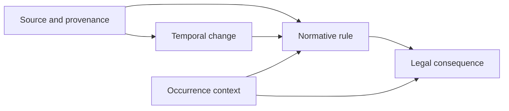
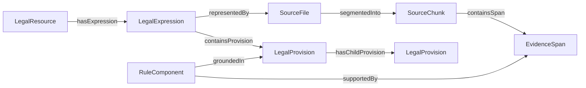
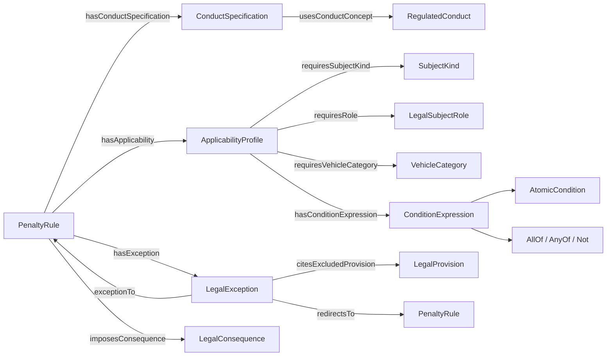
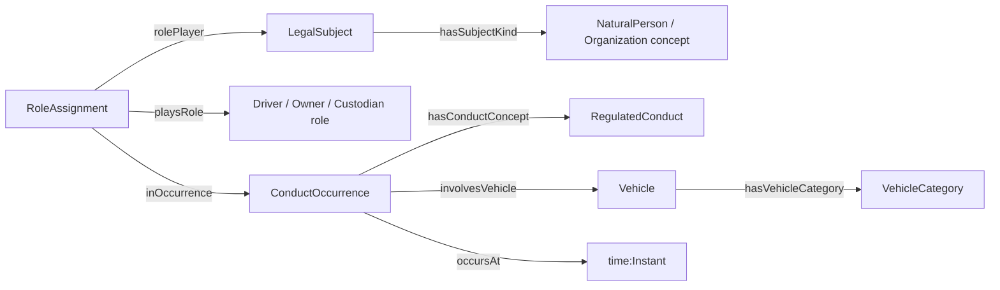
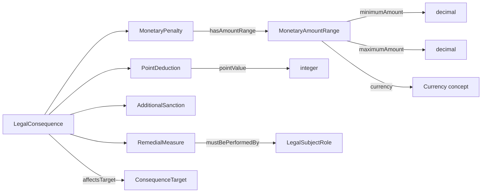
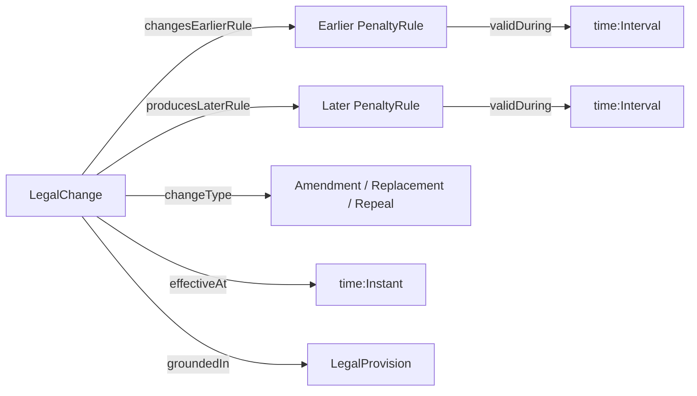

# Road Traffic Legal Ontology Construction Plan

Last updated: 2026-08-17

This is the living specification and work plan for constructing a canonical ontology for Vietnamese road-traffic
administrative penalties. Version 0.1 covers ontology requirements, Competency Questions (CQs), conceptualization,
formalization, and validation. Chunk processing, knowledge-graph population, retrieval, GraphRAG, Graphiti, and runtime
integration are explicitly outside this phase.

## Decision Status

The requirements and CQs below are a proposed version 0.1 baseline. They are concrete enough to begin glossary and
conceptual-model work, but a legal-domain reviewer must still approve their legal meaning. Existing synthesized facts
are examples for ontology engineering, not authoritative legal conclusions.

## Working Principles

- Follow NeOn for requirements, reuse, modularization, and traceability.
- Use METHONTOLOGY for conceptualization, formalization, and continuous evaluation.
- Develop the minimum model required by approved CQs instead of turning every corpus term into a class.
- Keep ontology construction separate from ontology population: chunks provide evidence for instances after the schema
  is approved; they do not define the schema automatically.
- Treat LLM output as candidate material. Humans own legal meaning, identity criteria, axioms, reuse decisions, and
  final approval.
- Do not use regex, keyword rules, handcrafted scores, or rule engines to make semantic modeling decisions.
- Version every approved requirement, CQ, definition, modeling decision, formal artifact, and validation fixture.

## Construction and Population Boundary

This document covers only the left side of the boundary:

```text
Ontology construction                              Later ontology population
---------------------                              ---------------------------
Purpose and scope                                  Structured legal chunks
  -> Competency Questions                            -> typed candidate extraction
  -> glossary and reuse decisions                    -> cross-chunk rule assembly
  -> conceptual modules                              -> entity resolution
  -> classes, relationships, constraints             -> constraint and provenance checks
  -> CQ and logical validation                       -> approved instance graph
```

Chunking is therefore not the starting point for ontology design. A chunk is a source and evidence unit. It must not
be assumed to equal one legal rule, because a rule's conduct, consequence, exception, and amendment may occur in
different provisions or chunks.

## Ontology Requirements Specification V0.1

### Purpose

| ID | Requirement |
| --- | --- |
| `PURP-001` | Provide explicit and versioned semantics for Vietnamese road-traffic administrative penalty rules. |
| `PURP-002` | Represent enough legal context to distinguish rules that concern similar conduct but differ by subject, vehicle, condition, exception, source, or effective time. |
| `PURP-003` | Make every material assertion traceable to an authoritative provision and exact evidence span. |

### Intended Uses

| ID | Requirement |
| --- | --- |
| `USE-001` | Describe a penalty rule as a contextual legal object rather than an unconditional conduct-to-penalty pair. |
| `USE-002` | Determine which legal consequences apply when conduct, subject role, vehicle category, conditions, and date are known. |
| `USE-003` | Explain why two similar cases have different consequences. |
| `USE-004` | Represent amendments and determine which version of a rule is applicable at a specified date. |
| `USE-005` | Validate ontology completeness and correctness through executable CQ fixtures in a later formalization phase. |

These uses describe domain semantics only. They do not specify retrieval, ranking, answer generation, graph traversal,
or any storage framework.

### Intended Users

| ID | User | Responsibility |
| --- | --- | --- |
| `USER-001` | Ontology engineer | Maintains requirements, definitions, modules, axioms, and validation fixtures. |
| `USER-002` | Vietnamese legal-domain reviewer | Approves legal definitions, applicability distinctions, examples, and CQ answers. |
| `USER-003` | Data-model or extraction engineer | Uses the approved ontology as the contract for later typed instance extraction. |

### In Scope

| ID | Required capability |
| --- | --- |
| `SCOPE-001` | Legal documents, provisions, citations, chunks, quoted evidence spans, and issuing bodies. |
| `SCOPE-002` | Regulated conduct and the legal rule that regulates it. |
| `SCOPE-003` | Legal subjects, contextual subject roles, and vehicle categories. |
| `SCOPE-004` | Applicability conditions and exceptions. |
| `SCOPE-005` | Monetary penalties, driver-license point deductions, additional sanctions, and remedial measures. |
| `SCOPE-006` | Effective intervals, amendment, replacement, and supersession of rules or provisions. |
| `SCOPE-007` | Direct provenance from a modeled rule and consequence to the provisions and evidence that support them. |

### Scope Boundary

The `in_scope` registry is closed: only listed capabilities belong to V0.1. Anything not listed is outside the current
ontology-construction scope and requires an explicit versioned scope addition before it can drive ontology terms or
constraints.

### Required Granularity

| ID | Decision |
| --- | --- |
| `GRAN-001` | A legal rule is distinguishable from the conduct it regulates and the consequence it imposes. |
| `GRAN-002` | A subject role such as `người điều khiển xe` is distinguishable from a natural or legal person. |
| `GRAN-003` | Vehicle category is modeled separately when it changes applicability or consequence. |
| `GRAN-004` | Conditions and exceptions are first-class candidates because they may have provenance and may alter applicability. |
| `GRAN-005` | Monetary amount, point deduction, additional sanction, and remedial measure are distinct consequence kinds. |
| `GRAN-006` | A provision citation and its exact quoted evidence are distinct provenance objects. |
| `GRAN-007` | Temporal applicability belongs to the rule or legal expression, not to the conduct in the abstract. |
| `GRAN-008` | The same normalized conduct may participate in multiple rules without forcing those rules to be identical. |

### Assumptions and Open Decisions

- **Baseline assumption:** V0.1 models administrative penalty rules and the traffic obligations needed to identify their
  regulated conduct; it does not attempt to model all road-traffic law.
- **Baseline assumption:** both original/amending legal expressions and consolidated expressions may be represented,
  but their identity and authority must not be conflated.
- **Selected for draft formalization:** use OWL 2 DL with open-world semantics; keep required-field, cardinality,
  datatype, provenance-completeness, and temporal-order validation in a separate SHACL graph.
- **Open:** name the legal-domain reviewer or define the approval process.
- **Completed initial review:** Traffic Law Knowledge Base V1 and the principal external reuse candidates have been
  inventoried. The pilot conceptual model is now selected; term-level mappings remain pending legal and ontology review.

## Candidate Core Model

The following was the initial hypothesis used to derive the CQ and glossary work. The detailed pilot conceptual model
later in this document refines `appliesTo` into an applicability profile and adds component-level provenance. It remains
a summary, not a formal class diagram:

```text
PenaltyRule
  regulatesConduct   -> RegulatedConduct
  appliesTo           -> LegalSubjectRole
  concernsVehicle     -> VehicleCategory
  hasCondition        -> ApplicabilityCondition
  hasException        -> LegalException
  imposesConsequence  -> LegalConsequence
  groundedIn          -> LegalProvision
  validDuring         -> ValidityInterval

LegalConsequence
  |- MonetaryPenalty
  |- PointDeduction
  |- AdditionalSanction
  `- RemedialMeasure
```

`PenaltyRule` is the initial modeling center because a direct relation such as
`RegulatedConduct -> hasPenalty -> MonetaryPenalty` loses the subject, vehicle, condition, exception, temporal, and
provenance context needed by the mandatory CQs.

## Reuse Inventory and Decisions V0.1

### Evaluation Criteria

A resource is not reused merely because it contains a similarly named class. Reuse requires:

- semantic compatibility with the approved CQs and scope;
- a stable and resolvable namespace;
- explicit version and maintenance information;
- a license compatible with referencing, importing, adapting, or redistributing the artifact;
- acceptable logical commitments and dependency size;
- definitions and examples precise enough to review;
- a documented mapping that preserves local legal distinctions.

The decision labels used below are:

| Decision | Meaning |
| --- | --- |
| `reuse` | Use the external term with its published IRI and semantics. |
| `align` | Keep a local term and record a semantic mapping after compatibility is proven. |
| `adapt` | Reuse a modeling idea or restricted pattern, but define a reviewed local term. |
| `reference` | Use the resource as design guidance without importing or mapping formal terms yet. |
| `reject` | Do not use the resource for V0.1 and record why. |

### Resource Inventory

| Decision ID | Resource | Verified artifact information | Candidate contribution | V0.1 decision |
| --- | --- | --- | --- | --- |
| `REUSE-TLKB-001` | [Traffic Law Knowledge Base V1](https://drive.google.com/drive/folders/1uMA9Zu1IDwmoVdLhc_C9gvYvJta_1vcW) | Version `1.0.0`, created 2026-07-15; 94 classes, 44 object properties, 23 datatype properties, 7 SHACL shapes, 10 SPARQL queries, and 50 CQs | Vietnamese labels, penalty vocabulary, CQ comparison set, SHACL examples, and candidate document/consequence concepts | `reference` and selective `adapt`; do not import or copy terms yet |
| `REUSE-ELI-001` | [European Legislation Identifier ontology](https://op.europa.eu/en/web/eu-vocabularies/eli) | Official ELI ontology version `1.4`; namespace `http://data.europa.eu/eli/ontology#`; legislation metadata model based on Work/Expression/Format distinctions | Legal-resource identity, expressions, formats, publication metadata, dates, and change relationships | `align` selected source/provenance terms; do not import the entire ontology before mapping |
| `REUSE-PROV-001` | [PROV-O](https://www.w3.org/TR/prov-o/) | W3C Recommendation; namespace `http://www.w3.org/ns/prov#` | Entity/activity/agent provenance, generation, derivation, attribution, and review activities | `reuse` a minimal subset by published IRI; extend locally for exact evidence spans and supported assertions |
| `REUSE-TIME-001` | [OWL-Time](https://www.w3.org/TR/owl-time/) | W3C Recommendation; namespace `http://www.w3.org/2006/time#` | Instants, intervals, beginnings, ends, and temporal relations | `reuse` temporal primitives; define legal validity and applicability semantics locally |
| `REUSE-SKOS-001` | [SKOS](https://www.w3.org/TR/skos-reference/) | W3C Recommendation; namespace `http://www.w3.org/2004/02/skos/core#` | Controlled vocabularies, multilingual labels, definitions, broader/narrower concepts, and mapping relations | `reuse` for candidate conduct and vehicle concept schemes; do not use SKOS hierarchy as legal subclass inference automatically |
| `REUSE-LKIF-001` | [LKIF-Core](https://github.com/RinkeHoekstra/lkif-core) | Modular ontology library; repository revision reviewed from 2026-02-23; license updated to CC BY 4.0; original semantic modules largely date from 2007-2008 | Role pattern, legal roles, norms, legal expressions, actions, and modification concepts | `reference` and possible selective `adapt`; do not import the broad dependency chain or legacy HTTP imports in V0.1 |
| `REUSE-AKN-001` | [Akoma Ntoso 1.0](https://docs.oasis-open.org/legaldocml/akn-core/v1.0/os/part1-vocabulary/akn-core-v1.0-os-part1-vocabulary.html) | OASIS Standard for XML representation and vocabulary of legal documents | Article/clause/point structure and mapping from source-document markup | `reference`; no OWL import because it is a document XML standard, not the canonical domain ontology |
| `REUSE-LRML-001` | [LegalRuleML 1.0](https://docs.oasis-open.org/legalruleml/legalruleml-core-spec/v1.0/os/legalruleml-core-spec-v1.0-os.html) | OASIS Standard for structured legal rules | Rule statements, deontic constructs, exceptions, defeasibility, temporal and jurisdictional annotations | `reference`; defer rule-language serialization and defeasible reasoning beyond the V0.1 OWL conceptual model |
| `REUSE-ODP-001` | [W3C n-ary relation pattern](https://www.w3.org/TR/swbp-n-aryRelations/) and ontology design patterns | Stable design guidance rather than a domain vocabulary | Reification of a rule that has conduct, participants, conditions, consequences, time, and provenance | `adapt` the pattern conceptually; no external ontology import is required |

### Traffic Law Knowledge Base V1 Findings

The bundle contains:

```text
README.md
competency_questions_v1.md
traffic_law_ontology_v1.ttl
traffic_law_shapes_v1.ttl
sample_queries_v1.sparql
```

The supplied ontology declares namespace `https://w3id.org/vn-traffic-law/ontology#` and version IRI
`https://w3id.org/vn-traffic-law/ontology/1.0.0`. At review time, the namespace URL returned HTTP 404. The bundle has
no explicit license or copyright grant, no `owl:imports`, and no `rdfs:comment` or `skos:definition` definitions for its
94 classes. Therefore, labels and formal declarations cannot be treated as sufficient semantic or legal permission to
reuse its IRIs or copy its ontology content.

Useful material to retain as candidates:

- `AdministrativeViolationNorm` as a comparison point for `PenaltyRule`;
- consequence distinctions for monetary fine, point deduction, additional sanction, and remedial measure;
- document/provision vocabulary and amendment/replacement/repeal relation candidates;
- Vietnamese labels and the 50-CQ coverage checklist;
- SHACL examples for monetary bounds, point values, provenance presence, and temporal ordering;
- CQ themes concerning insufficient context, source traceability, and historical applicability.

Material that must not be adopted unchanged:

- `Driver` and `VehicleOwner` are modeled as subclasses of person or legal subject, which risks conflating contextual
  roles with stable entity types;
- `appliesToSubject`, `appliesToVehicle`, and `regulatesConduct` point to `owl:Class`, introducing a class-as-value
  metamodeling commitment that must be justified before use;
- applicability conditions do not preserve AND/OR/NOT composition, scope, or per-condition evidence;
- provenance is primarily norm-to-`SourceFragment`, not assertion-level provenance for each material condition or
  consequence;
- temporal validity uses flat `effectiveFrom` and `effectiveTo` values without OWL-Time or a clear rule-version identity;
- document, document version, consolidated document, file, and legal expression distinctions are incomplete;
- the point range `1..12`, mandatory source URL, exact-one legal status, and other SHACL constraints require legal and
  data-policy verification before reuse;
- confidence score, retrieval-oriented CQ acceptance, procedure, criminal liability, and local-law conflict are outside
  the current construction scope.

The 50 external CQs remain a comparison backlog. They are not substituted for the repository's 16 mandatory CQs
because many lack motivating scenarios, positive/boundary examples, and explicit answer shapes, while several depend on
retrieval, procedures, authority, criminal liability, or local-law conflict that V0.1 deliberately excludes.

### Planned Term-Level Reuse

| Local pre-glossary area | External source | Planned use | Constraint |
| --- | --- | --- | --- |
| Legal document identity and expressions | ELI `LegalResource`/`Work`, `LegalExpression`/`Expression`, and `Format` concepts | Align local document, expression, and file/manifestation distinctions after testing Vietnamese consolidation and amendment examples | Do not assume EU publication lifecycle semantics are identical to Vietnamese legal-document practice |
| Extraction and review provenance | PROV-O `Entity`, `Activity`, `Agent`, `wasGeneratedBy`, `wasDerivedFrom`, and `wasAssociatedWith` | Reuse published terms for extraction and review activities | Exact quote selectors, chunk locations, and assertion support remain local extensions |
| Legal validity intervals | OWL-Time `Instant`, `Interval`, `hasBeginning`, `hasEnd`, and XSD date representations | Reuse temporal primitives | Legal effect, amendment, repeal, and applicability are domain relations, not generic time relations |
| Vehicle, subject-kind, and conduct vocabularies | SKOS `ConceptScheme`, `Concept`, labels, notes, and mapping properties | Represent multilingual controlled concepts and candidate normalization mappings | `skos:broader` must not silently imply `rdfs:subClassOf` |
| Legal roles and norms | LKIF role and norm modules | Compare role identity and norm reification alternatives during conceptual modeling | Prefer a small local adaptation unless the imported axioms and full dependency chain are proven necessary |
| Article/clause/point structure | Akoma Ntoso plus ELI structural metadata | Guide mappings from source markup and provision locators | Keep processing markup separate from domain semantics |
| Conditions and exceptions | LegalRuleML and n-ary relation patterns | Inform expression, scope, exception-target, and provenance design | Do not introduce a rule engine or full LegalRuleML serialization in V0.1 |

### Namespace and Licensing Policy

- Do not mint or publish terms under the unresolvable Traffic Law KB V1 `w3id.org` namespace.
- Do not copy or redistribute Traffic Law KB V1 ontology statements until the owner supplies an explicit license.
- Reference W3C and OASIS standards through their canonical published IRIs and specifications; avoid vendoring complete
  artifacts unless required and license-reviewed.
- Preserve attribution for any LKIF-Core content adapted under CC BY 4.0.
- Use the proposed canonical root `https://w3id.org/legal-ontology-rag/ontology` with version IRIs and module-specific
  namespaces. Treat it as non-resolvable until its redirect is registered and verified; public release is blocked until
  that registration and an ontology license are complete.
- Record every external mapping with source version, relation type, reviewer, and rationale. Similar labels alone do not
  justify `owl:equivalentClass` or `owl:equivalentProperty`.

## Competency Question Specification

### CQ Quality Gate

Every CQ must be understandable without seeing code, answerable from an intended ontology instance, limited to the
approved scope, and traceable to an intended use. Before approval, a reviewer must confirm:

- the question has a real motivating scenario and a clearly identified user;
- all context required for a legally meaningful answer is present or explicitly treated as unknown;
- the expected answer shape names entities, values, relationships, and provenance rather than a prose-only answer;
- the positive example demonstrates the intended answer;
- the boundary example demonstrates when the answer changes, is inapplicable, or cannot be determined;
- the CQ does not silently require retrieval, ranking, sanction aggregation, or procedural reasoning.

### Mandatory CQ Backlog

All CQs below are `Must` for V0.1. Their examples come from current synthesized artifacts and must be checked against
the authoritative source text before becoming acceptance fixtures.

#### Rule and Applicability

| CQ ID | Type | Natural-language question | Expected answer shape | Positive example | Boundary example |
| --- | --- | --- | --- | --- | --- |
| `CQ-RULE-001` | Validation | Với hành vi, vai trò chủ thể, loại phương tiện, điều kiện và ngày xảy ra đã biết, quy tắc xử phạt nào áp dụng? | `PenaltyRule`, matched conduct, role, vehicle, satisfied conditions, effective interval, source provision | Người điều khiển xe thực hiện hành vi thuộc NĐ 168 vào ngày 2025-01-01 returns the matching rule and provision. | Missing subject role or occurrence date may yield multiple candidates or `insufficient context`, not one unconditional rule. |
| `CQ-APPLICABILITY-001` | Relationship | Một quy tắc xử phạt áp dụng cho vai trò chủ thể và loại phương tiện nào? | Rule -> subject role; optional rule -> vehicle category; provenance | `Vượt bên phải...` distinguishes a general driver example from a bicycle/primitive-vehicle driver example. | A person who owns a vehicle but was not acting in the required driver role must not match solely because both are persons. |
| `CQ-CONDITION-001` | Relationship | Những điều kiện nào phải thỏa mãn để quy tắc áp dụng? | Rule -> each applicability condition; condition source; conjunction/grouping when expressed | `Điều khiển xe không gắn biển số` carries the condition that the vehicle type is required to have a plate. | If the vehicle category is not legally required to have a plate, the condition is not satisfied. |
| `CQ-EXCEPTION-001` | Relationship | Ngoại lệ nào loại trừ hoặc chuyển trường hợp khỏi quy tắc chung, và ngoại lệ dẫn tới quy tắc nào nếu có? | General rule, exception, excluded case, optional more-specific rule, supporting provisions | The general road-sign rule excludes conduct enumerated in more-specific clauses of Article 6. | Free text beginning with `trừ` is not automatically an exception until its legal function and target are established. |
| `CQ-NEGATIVE-001` | Validation | Khi thiếu thông tin ngữ cảnh nào thì chưa thể xác định duy nhất quy tắc áp dụng? | Missing context dimensions and remaining candidate rules; no fabricated consequence | Same normalized conduct with several vehicle-specific rules reports `vehicle category` as missing. | A single lexical match must not be treated as sufficient evidence of applicability. |

#### Consequences

| CQ ID | Type | Natural-language question | Expected answer shape | Positive example | Boundary example |
| --- | --- | --- | --- | --- | --- |
| `CQ-PENALTY-001` | Validation | Quy tắc áp dụng quy định mức phạt tiền tối thiểu, tối đa và đơn vị tiền tệ nào? | Rule -> `MonetaryPenalty`; minimum amount; maximum amount; currency; source | `Điều khiển xe không gắn biển số` returns 4,000,000-6,000,000 VND from the cited provisions. | A rule with only a remedial measure returns no monetary penalty instead of amount zero. |
| `CQ-CONSEQUENCE-001` | Validation | Ngoài phạt tiền, quy tắc còn áp dụng hậu quả pháp lý nào? | All consequences grouped by kind: points, additional sanctions, remedies; each with source | The no-plate example returns six points and confiscation of the plate in addition to the monetary range. | Absence of extracted data is not evidence that the legal rule has no other consequence. |
| `CQ-POINTS-001` | Validation | Quy tắc có trừ điểm giấy phép lái xe không; nếu có thì bao nhiêu điểm và áp dụng cho vai trò nào? | Rule -> point deduction value; affected license/role when stated; source | A driver rule in NĐ 168 returns a six-point deduction for the no-plate example. | A monetary penalty applying to an organization must not inherit a driver's point deduction. |
| `CQ-ADDITIONAL-001` | Validation | Hình thức xử phạt bổ sung nào đi kèm quy tắc và đối tượng của hình thức đó là gì? | Rule -> additional sanction; sanction target; source | The no-plate example identifies confiscation of the plate as an additional sanction. | Confiscation of an object and license-point deduction remain different consequence kinds. |
| `CQ-REMEDY-001` | Validation | Biện pháp khắc phục hậu quả hoặc nghĩa vụ khôi phục nào được quy tắc yêu cầu, ai phải thực hiện và trong điều kiện nào? | Rule -> remedial measure; responsible role; condition; provenance | NĐ 168 Article 13(8)(b) and (11)(a) connect a plate-related violation to the expressly classified duty to restore compliance or the original state. | A duty copied into an administrative form is not accepted as a remedial measure until a normative provision supports that classification. |

#### Provenance and Time

| CQ ID | Type | Natural-language question | Expected answer shape | Positive example | Boundary example |
| --- | --- | --- | --- | --- | --- |
| `CQ-SOURCE-001` | Validation | Quy tắc và từng hậu quả pháp lý được quy định trực tiếp tại văn bản, điều, khoản, điểm nào? | Rule/consequence -> document and structured provision citation | The no-plate rule traces monetary penalty, points, and confiscation to their respective clauses. | A document-level citation alone is insufficient when the supporting clause is known. |
| `CQ-EVIDENCE-001` | Validation | Đoạn văn chính xác nào làm bằng chứng cho một điều kiện, ngoại lệ hoặc hậu quả đã mô hình hóa? | Assertion -> quoted span -> source chunk/provision/document | A point deduction assertion returns the exact quoted span that states the number of points. | A chunk containing related text but not the asserted consequence is not sufficient evidence. |
| `CQ-TEMPORAL-001` | Validation | Tại ngày xảy ra hành vi, phiên bản quy tắc nào có hiệu lực? | Date, applicable rule expression, effective interval, source; excluded versions with reason | A rule effective from 2025-01-01 is applicable to an event on that date if no later replacement governs it. | `valid_to = null` in synthesized data does not prove that a rule remains legally effective forever. |
| `CQ-TEMPORAL-002` | Relationship | Một quy tắc đã thay đổi như thế nào trước và sau văn bản sửa đổi hoặc thay thế? | Earlier and later rule expressions; change relation; changed applicability/consequence fields; effective dates | NĐ 238 Article 3 explicitly amends NĐ 168 Article 13(8)(b), producing a later expression effective from 2026-08-15. | Similar wording in a later document is not enough to assert amendment or replacement without legal evidence. |

#### Comparison and Rule Assembly

| CQ ID | Type | Natural-language question | Expected answer shape | Positive example | Boundary example |
| --- | --- | --- | --- | --- | --- |
| `CQ-COMPARISON-001` | Validation | Hai trường hợp có hành vi tương đương khác hậu quả vì khác vai trò chủ thể hoặc loại phương tiện như thế nào? | Two rules, shared/different context dimensions, consequences, sources | `Vượt bên phải...` can be compared across a driver rule and a bicycle/primitive-vehicle driver rule with different monetary ranges. | Lexically similar conduct is not declared equivalent without an approved normalization or equivalence decision. |
| `CQ-ASSEMBLY-001` | Foundational | Những điều khoản hoặc đoạn bằng chứng nào cùng cấu thành một quy tắc hoàn chỉnh? | One rule -> multiple supporting provisions/spans, with the contribution of each source | The no-plate rule assembles monetary penalty, point deduction, and additional sanction from several cited clauses. | One chunk is not assumed to equal one rule, and nearby chunks are not merged solely because of document order. |

### CQ Approval Record

For each CQ, record these fields when it moves from this document into a versioned machine-readable artifact:

```text
cq_id
version
status: draft | approved | formalized | passing | retired
question_vi
cq_type
motivating_scenario
intended_user
expected_answer_shape
positive_example
boundary_example
priority
requirement_ids
candidate_modules
authoritative_sources
owner
```

An LLM may propose, decompose, or paraphrase CQs. A human reviewer must approve the scenario, legal interpretation,
priority, expected answer, and boundary behavior.

## Pilot CQ Cluster

### Selected Cluster

The first conceptual-model increment covers:

```text
RegulatedConduct
+ PenaltyRule
+ LegalSubjectRole
+ VehicleCategory
+ ApplicabilityCondition
+ LegalException
+ MonetaryPenalty
+ PointDeduction
+ AdditionalSanction
+ RemedialMeasure
+ LegalProvision and EvidenceSpan
+ ValidityInterval and change relation
```

It targets all mandatory CQs but does not attempt to model the full legal domain. The conceptual model should be split
into four cohesive modules:

| Module | Responsibility |
| --- | --- |
| Source and provenance | Document, legal expression, provision, chunk, quoted span, and citation. |
| Normative rule | Penalty rule, regulated conduct, subject role, vehicle category, condition, and exception. |
| Legal consequence | Monetary penalty, point deduction, additional sanction, and remedial measure. |
| Temporal change | Effective interval and evidence-backed amendment, replacement, or supersession relations. |

### Candidate Pilot Fixtures

These records provide modeling stress cases. A verified status means that the cited source text supports the stated
modeling use; it does not make the persisted `LegalFact` record authoritative or silently correct its fields.

| Candidate | Why selected | CQs exercised | Verification status |
| --- | --- | --- | --- |
| Fact `17d76de...` - no plate, NĐ 168, Article 14(3)(a), (5)(a), and (8)(b) | One rule with condition, monetary range, points, additional sanction, and multi-provision assembly | `CQ-CONDITION-001`, `CQ-PENALTY-001`, `CQ-POINTS-001`, `CQ-ADDITIONAL-001`, `CQ-ASSEMBLY-001` | verified with corrected full paths and heading-derived applicability |
| Fact `ce413f01...` - failure to follow signs/markings, Article 6(1)(a) | Broad exclusion list that tests the difference between condition and exception | `CQ-EXCEPTION-001`, `CQ-SOURCE-001` | verified; 30 cited locators resolve to 32 point-level targets, three of which have later target versions under NĐ 238 |
| Facts `03386949...` and `964ee842...` - prohibited right-side passing | Similar conduct with different subject/vehicle contexts and monetary ranges | `CQ-APPLICABILITY-001`, `CQ-COMPARISON-001`, `CQ-NEGATIVE-001` | verified; the first record loses Article 7 heading context |
| Fact `e394749f...` - unsafe road obstruction/discharge | Point deduction depends on the additional condition that the individual is a vehicle operator | `CQ-CONDITION-001`, `CQ-POINTS-001` | verified with Article 12(11)(a) and (17) as separate supporting provisions |
| Fact `0c0dcf27...` - use of an administratively detained vehicle | Tests whether an extracted post-violation duty is truly a modeled remedial measure | `CQ-REMEDY-001`, `CQ-CONSEQUENCE-001` | rejected as a normative fixture; evidence comes from attached form `Bieu mau.doc` |
| Facts `027e7dc8...` and `3673bb62...` - organization owner does not cooperate | Tests the evidence threshold for cross-document temporal identity | `CQ-TEMPORAL-001`, `CQ-TEMPORAL-002` | rejected as a before/after pair; NĐ 168 Article 47(8)(b) and NĐ 336 Article 22(2)(b) govern different decree scopes without an evidenced change link |
| Fact `11091af3...` - traffic accident consequence and ten-point deduction | Composite conduct wording and a severe consequence bundle | `CQ-RULE-001`, `CQ-CONSEQUENCE-001` | verified with Article 7(10)(a) and (13)(d) |
| Fact `d801280d...` - plate compliance and restoration duty, NĐ 168 Article 13(8)(b) and (11)(a) | Authoritatively classified remedial measure and an explicit later amendment | `CQ-REMEDY-001`, `CQ-TEMPORAL-001`, `CQ-TEMPORAL-002` | verified as the replacement remedy/temporal fixture; NĐ 238 Article 3 amends Article 13(8)(b) from 2026-08-15 |

Before use as validation fixtures, retrieve each record's quoted evidence, inspect the complete provision context, and
verify the document's legal status and effective dates. Do not treat `valid_to = null` as verified continuing validity.

### Pilot Source Verification

Verification inspected the structural context in the source DOCX files, including article headings and separately cited
consequence clauses. Extracted records remain benchmark artifacts and are not edited in place.

| Finding | Source evidence | Modeling impact |
| --- | --- | --- |
| The no-plate rule is scoped by the Article 14 heading to motorcycle, moped, and similar-vehicle drivers. | NĐ 168 Article 14(3)(a), (5)(a), and (8)(b). | Preserve heading-derived role and vehicle applicability; attach provenance separately to money, confiscation, and points. |
| The general signs/markings rule contains an explicit list of excluded provisions in the same article. | NĐ 168 Article 6(1)(a). | Model one evidenced exclusion statement citing 30 locators that resolve to 32 point-level targets; link target rules only after rule assembly. |
| The two right-side-passing records have different article-heading scopes and monetary ranges. | NĐ 168 Article 7(3)(đ) and Article 9(1)(d). | Keep legal role and vehicle category separate; do not rely on the first record's generic extracted subject. |
| The point deduction for obstruction/discharge is supported outside the monetary-penalty clause and applies only when the individual is a vehicle operator. | NĐ 168 Article 12(11)(a) and (17). | Represent the role condition on the point consequence and retain component-level provenance. |
| The detained-vehicle record was extracted from an attached administrative form rather than the decree's normative article structure. | Attachment `Bieu mau.doc`, form content headed `Quyền và nghĩa vụ`, item 3(b). | Do not treat attachment content as a `LegalProvision` or classify its duties as `RemedialMeasure` without a governing normative citation. |
| The organization-owner passages are textually similar but are not an evidenced amendment pair. | NĐ 168 Article 47(8)(b) covers traffic-safety enforcement; NĐ 336 Article 22(2)(b) covers road-activity enforcement. | Similarity may support comparison, not `amends`, `replaces`, `supersedes`, or shared enduring rule identity. |
| The accident rule assembles its fine and point deduction from separate clauses. | NĐ 168 Article 7(10)(a) and (13)(d). | Preserve a composite conduct specification and separately evidenced consequences. |
| A genuine explicit amendment is available for the temporal pilot. | NĐ 238 Article 3 amends NĐ 168 Article 13(8)(b); NĐ 238 is effective from 2026-08-15. | Use an evidenced `LegalChange` event and distinct earlier/later rule expressions; Article 13(11)(a) supplies the associated remedial classification. |

NĐ 168 took effect on 2025-01-01 for the reviewed pilot provisions. NĐ 238 took effect on 2026-08-15. The selected
NĐ 168 no-plate, right-side-passing, obstruction/discharge, and accident provisions were not changed by NĐ 238. The
wording of the signs/markings rule also remains unchanged, but three of its cited exclusion targets receive later rule
versions. The replacement temporal fixture at Article 13(8)(b) was changed directly and therefore requires two
validity-bounded rule expressions. Legal status must be rechecked when the corpus gains another amending or repealing
document.

### Article 6(1)(a) Exception Target Resolution

The phrase beginning with `trừ` in NĐ 168 Article 6(1)(a) is legally functional: it removes cases addressed by cited
specific provisions from the general signs/markings offense. It is not merely descriptive text and is not modeled as
one negated atomic condition. The 30 cited locators resolve to 32 point-level targets because the whole-clause citation
to clause 7 contains three points.

| Cited target | Provision-defined excluded case | Resolution |
| --- | --- | --- |
| Article 6(2)(a) | Improper lane change or missing lane-change signal. | Specific-offense target; its later expression includes unsafe lane-change distance under NĐ 238 Article 19(2). |
| Article 6(2)(c) | Failure to yield at a road intersection. | Specific-offense target. |
| Article 6(2)(d) | Specified improper stopping or parking outside urban areas. | Specific-offense target. |
| Article 6(2)(đ) | Specified improper stopping or parking near curbs, bus lanes, utilities, fire access, pedestrian crossings, or prohibitory signs. | Specific-offense target. |
| Article 6(3)(a) | Exceeding the speed limit by 5 km/h to under 10 km/h. | Specific-offense target. |
| Article 6(3)(d) | Improper stopping or parking at a level railway crossing or within railway protection and safety areas. | Specific-offense target. |
| Article 6(3)(đ) | Stopping or parking at specified intersections, entrances, narrow roads, obscured signs or signals, median openings, or unsafe opposing distances. | Specific-offense target. |
| Article 6(3)(e) | Specified improper parking near curbs, bus lanes, utilities, sidewalks, fire access, or prohibitory signs. | Specific-offense target. |
| Article 6(3)(n) | Driving in a road tunnel without low-beam lighting. | Specific-offense target. |
| Article 6(3)(o) | Driving below the posted minimum speed. | Specific-offense target. |
| Article 6(4)(a) | Entering an electronic toll-only lane without the required tag. | Specific-offense target. |
| Article 6(4)(b) | Stopping or parking on the prohibited side of a road, near obscured curves or slopes, on bridges, under overpasses, or parallel to another stopped vehicle. | Specific-offense target. |
| Article 6(4)(đ) | Reversing, turning, stopping, parking, or failing to provide required warnings in a road tunnel. | Specific-offense target. |
| Article 6(4)(e) | Reversing in prohibited locations or without required observation or signaling. | Specific-offense target. |
| Article 6(4)(i) | Turning around at specified prohibited locations unless directed or expressly allowed. | Specific-offense target. |
| Article 6(4)(k) | Turning around, left, or right contrary to a sign prohibiting that maneuver for the vehicle category. | Specific-offense target. |
| Article 6(4)(l) | Failing to maintain safe distance or the distance required by a minimum-distance sign. | Specific-offense target. |
| Article 6(5)(a) | Prohibited overtaking, including overtaking contrary to a sign or impermissible right-side overtaking. | Specific-offense target. |
| Article 6(5)(b) | Driving on the wrong side, wrong road section, wrong lane, or across a fixed median. | Specific-offense target. |
| Article 6(5)(c) | Improperly avoiding oncoming traffic or failing to yield at a narrow, sloped, or obstructed section. | Specific-offense target. |
| Article 6(5)(d) | Violating highway entry, exit, emergency-lane, shoulder, or following-distance requirements. | Specific-offense target. |
| Article 6(5)(đ) | Exceeding the speed limit by 10 km/h to 20 km/h. | Specific-offense target. |
| Article 6(5)(i) | Entering a prohibited area or road for the vehicle category. | Specific-offense target; its later expression also covers a competent-authority prohibition under NĐ 238 Article 19(3). |
| Article 6(5)(k) | Improper stopping, parking, or turning that causes congestion. | Specific-offense target. |
| Article 6(6)(a) | Exceeding the speed limit by over 20 km/h to 35 km/h. | Specific-offense target. |
| Article 6(7)(a) | Exceeding the speed limit by over 35 km/h. | Point-level target included through the whole-clause citation. |
| Article 6(7)(b) | Driving a motorized passenger or cargo four-wheel vehicle on a highway. | Point-level target included through the whole-clause citation. |
| Article 6(7)(c) | Improper highway stopping or parking, including missing emergency and distance warnings. | Point-level target included through the whole-clause citation; its later expression includes an emergency stopping strip under NĐ 238 Article 19(4). |
| Article 6(9)(b) | Failure to obey a traffic light. | Specific signal-offense target. |
| Article 6(9)(d) | Driving against one-way traffic or a no-entry-direction sign. | Specific-offense target. |
| Article 6(10)(a) | Listed unsafe driving maneuvers or prohibited-road entry that causes a traffic accident. | Aggravated-result target, not merely a synonym of the general offense. |
| Article 6(11)(đ) | Driving against traffic, reversing, or turning around on a highway. | Higher-severity highway target. |

The canonical exception object therefore needs two levels of resolution:

1. `citesExcludedProvision` records every cited provision immediately, even before a complete target rule exists.
2. `redirectsTo` links zero or more assembled target `PenaltyRule` versions when their conduct, applicability,
   consequences, and validity have been verified. When a cited target has several versions, all verified versions may
   be linked and the occurrence date is compared with each target's `validDuring` interval.

This distinction prevents a citation string from being mistaken for a rule identity. It also permits Article 6(1)(a)
to remain textually unchanged while a cited target receives a later expression under NĐ 238.

### Pilot Exit Criteria

The pilot is complete only when:

- each retained fixture is verified against authoritative source text, and rejected candidates are explicitly excluded;
- each mandatory CQ has at least one positive fixture and one boundary fixture;
- reviewers can answer the CQs from the conceptual model without relying on GraphRAG or database behavior;
- every conceptual element traces to a CQ, definition, source, reuse decision, or explicit modeling rationale;
- unresolved identity, role, condition, exception, and temporal decisions are documented rather than hidden in names;
- no OWL or SHACL artifact is created until the glossary and conceptual model are reviewed.

## Pilot Pre-Glossary V0.1

### Status and Interpretation

This pre-glossary is a terminology-analysis artifact, not a formal ontology. Definitions are deliberately operational:
they state the distinction needed by the mandatory CQs without yet asserting OWL classes, property domains, identity
rules, or necessary and sufficient conditions.

All entries remain `unresolved` until legal review and term-level reuse mappings are complete. The initial resource
inventory narrows the candidates but does not prove that any two terms are equivalent. A candidate modeling type is a
hypothesis for the conceptual-model phase. It must not be copied mechanically into OWL.

The current extraction field `subject` is known to combine a person or organization, a contextual legal role, and
sometimes a vehicle category. The pre-glossary separates those meanings. Likewise, the persisted `LegalFact` record is
an extraction artifact and is not automatically a domain class.

For every entry below, `authoritative_source` is currently `pending legal-source and reuse verification`. The following
repository artifacts are candidate evidence only:

| Term family | Candidate repository basis | Authoritative verification still required |
| --- | --- | --- |
| Rule, conduct, subject, condition, consequence | Mandatory CQs, `LegalFact` fields, and selected NĐ 168/NĐ 118 pilot records | Complete cited provisions and any applicable definitions in the governing legal documents |
| Source and provenance | `EvidenceReference`, document metadata, provision paths, chunks, and exact quoted spans | Official document identity/structure plus comparison with ELI, Akoma Ntoso, and PROV-O |
| Temporal change | Corpus metadata and candidate `temporal` evidence bundles | Promulgation/effective clauses, explicit amendment text, consolidated sources, and OWL-Time patterns |

Candidate synonyms are discovery aids, not equivalence axioms:

| Term ID | Candidate synonyms or variants | Caution |
| --- | --- | --- |
| `TERM-RULE-001` | quy định xử phạt, quy tắc chế tài | `LegalFact` is not a synonym; it is an extraction record. |
| `TERM-CONDUCT-001` | hành vi vi phạm, hành vi bị xử phạt, hành vi được quy định | `Violation` may also mean an occurrence or legal qualification and remains ambiguous. |
| `TERM-SUBJECT-002` | đối tượng áp dụng, vai trò pháp lý | A role label such as driver is not interchangeable with person or organization. |
| `TERM-VEHICLE-001` | loại xe, nhóm phương tiện | Legal categories may overlap or be defined differently across instruments. |
| `TERM-COND-001` | điều kiện, tình tiết áp dụng, điều kiện bổ sung | Do not merge automatically with exception or aggravating/mitigating circumstances. |
| `TERM-EXCEPTION-001` | trường hợp loại trừ, ngoại lệ áp dụng | A phrase introduced by `trừ` still requires semantic review. |
| `TERM-MONEY-001` | tiền phạt, mức phạt tiền | `Mức phạt` may refer to a range/value rather than the sanction itself. |
| `TERM-POINTS-001` | trừ điểm, khấu trừ điểm giấy phép lái xe | Do not confuse with scoring or ranking values. |
| `TERM-ADDITIONAL-001` | xử phạt bổ sung, hình phạt bổ sung | Preserve the terminology used by the authoritative legal source. |
| `TERM-REMEDY-001` | biện pháp khắc phục, nghĩa vụ khắc phục | Not every post-violation obligation is legally classified as a remedial measure. |
| `TERM-DOC-001` | văn bản quy phạm pháp luật, văn bản nguồn | A file or consolidated expression is not automatically the same document-level entity. |
| `TERM-PROVISION-001` | điều khoản, quy định, đơn vị cấu trúc | Article, clause, and point are structural levels, not exact synonyms. |
| `TERM-EVIDENCE-001` | trích dẫn bằng chứng, đoạn trích nguyên văn | A citation locator is different from the quoted evidence text. |
| `TERM-TIME-001` | thời gian hiệu lực, giai đoạn áp dụng | Promulgation date and effective date are not interchangeable. |
| `TERM-CHANGE-001` | sửa đổi, sửa đổi bổ sung | Amendment, replacement, repeal, and consolidation must remain distinct candidates. |

### Normative Rule and Applicability Terms

| Term ID | Preferred label (VI / EN) | Working definition | Positive example | Non-example or boundary | Candidate type | Main CQs | Status |
| --- | --- | --- | --- | --- | --- | --- | --- |
| `TERM-RULE-001` | Quy tắc xử phạt / Penalty rule | A contextual normative specification that connects regulated conduct with applicable subject roles, vehicle categories, conditions, exceptions, consequences, source, and temporal applicability. | The complete rule assembled for driving a vehicle without a required plate. | The phrase `4.000.000-6.000.000 đồng` alone is a consequence, not a complete rule. | Core domain entity or reified n-ary relation | `CQ-RULE-001`, `CQ-ASSEMBLY-001` | unresolved |
| `TERM-RULE-002` | Phiên bản quy tắc / Penalty rule version | A temporally and textually identifiable expression of a penalty rule that may differ from an earlier or later expression. | NĐ 168 Article 13(8)(b) before and after the explicit amendment made by NĐ 238 Article 3. | Two similar passages in NĐ 168 and NĐ 336 without a legal change link are not established versions of one rule. | Entity or temporal slice | `CQ-TEMPORAL-001`, `CQ-TEMPORAL-002` | unresolved |
| `TERM-RULE-003` | Thành phần quy tắc / Rule component | A material, independently evidenced part of a penalty rule, such as its conduct specification, applicability profile, condition, exception, or consequence. | The six-point deduction component supported by its own clause and quote. | A display-only label with no legal meaning is not a material rule component. | Abstract conceptual superclass | `CQ-EVIDENCE-001`, `CQ-ASSEMBLY-001` | unresolved |
| `TERM-CONDUCT-001` | Hành vi được điều chỉnh / Regulated conduct | A type or description of action, omission, or legally relevant behavior addressed by a rule. | `Điều khiển xe không gắn biển số` as the conduct described by a provision. | A particular driver's act at 09:00 on a given date is an occurrence, not the abstract conduct description. | Domain concept, possibly SKOS-backed | `CQ-RULE-001`, `CQ-COMPARISON-001` | unresolved |
| `TERM-CONDUCT-002` | Sự kiện hành vi / Conduct occurrence | A concrete occurrence in which an actor performs or omits conduct in a context and at a time. | A specified person drives a specified car without a plate on 2025-03-01. | The wording of the prohibited conduct in a decree is not itself an occurrence. | Event entity | `CQ-RULE-001`, `CQ-TEMPORAL-001`, `CQ-NEGATIVE-001` | unresolved |
| `TERM-CONDUCT-003` | Đặc tả hành vi trong quy tắc / Conduct specification | The rule component asserting that a penalty rule regulates a selected conduct concept, with independent provenance. | The component linking the no-plate rule to its normalized conduct concept. | The shared conduct concept itself is not duplicated for each rule. | Reified relation component | `CQ-RULE-001`, `CQ-EVIDENCE-001`, `CQ-ASSEMBLY-001` | unresolved |
| `TERM-APP-001` | Hồ sơ áp dụng / Applicability profile | A rule component collecting one coherent combination of required subject kind, role, vehicle category, and condition expression. | One profile for a natural person acting as driver of a category of vehicle. | A concrete person's case record is an occurrence context, not a rule applicability profile. | N-ary applicability entity | `CQ-APPLICABILITY-001`, `CQ-CONDITION-001`, `CQ-NEGATIVE-001` | unresolved |
| `TERM-SUBJECT-001` | Chủ thể pháp lý / Legal subject | A natural person or organization capable of bearing the relevant legal position. | A named individual or registered organization involved in a later case instance. | `Người điều khiển xe` describes a role and does not identify a particular legal subject. | Upper-level domain entity | `CQ-APPLICABILITY-001` | unresolved |
| `TERM-SUBJECT-002` | Vai trò chủ thể pháp lý / Legal subject role | A context-dependent capacity in which a legal subject participates and to which a rule applies. | Driver, vehicle owner, assigned custodian, or transported passenger. | Natural person and organization are subject kinds, not contextual roles. | Role entity or role class | `CQ-APPLICABILITY-001`, `CQ-POINTS-001`, `CQ-REMEDY-001` | unresolved |
| `TERM-SUBJECT-003` | Cá nhân / Natural person | The controlled subject-kind concept for a human legal subject, used when a rule or consequence distinguishes person-versus-organization status. | `Cá nhân` in a provision that sets a lower monetary range than for an organization. | `Người điều khiển xe` cannot be reduced to natural person because it adds a contextual role. | `SubjectKind` concept | `CQ-APPLICABILITY-001`, `CQ-COMPARISON-001` | unresolved |
| `TERM-SUBJECT-004` | Tổ chức / Organization | The controlled subject-kind concept for a non-natural legal subject recognized by the applicable framework. | `Chủ phương tiện là tổ chức`. | A government issuing body is not automatically the sanctioned organization in a penalty rule. | `SubjectKind` concept | `CQ-APPLICABILITY-001`, `CQ-TEMPORAL-002` | unresolved |
| `TERM-SUBJECT-005` | Loại chủ thể / Subject kind | A controlled classification of a legal subject, initially distinguishing natural person and organization without treating those kinds as property values that are OWL classes. | A subject classified with the `organization` concept. | Driver and owner are roles, not subject kinds. | Controlled concept | `CQ-APPLICABILITY-001`, `CQ-COMPARISON-001` | unresolved |
| `TERM-SUBJECT-006` | Sự gán vai trò / Role assignment | A contextual relation entity stating that a legal subject plays a legal role in a conduct occurrence or other specified context. | A person plays driver role in one occurrence and owner role in another. | Declaring every vehicle owner to be a driver is not a role assignment. | Role-pattern entity | `CQ-RULE-001`, `CQ-APPLICABILITY-001`, `CQ-NEGATIVE-001` | unresolved |
| `TERM-VEHICLE-001` | Loại phương tiện / Vehicle category | A legally relevant category of vehicle used to delimit applicability or consequences. | Car, motorcycle, bicycle, or other primitive vehicle when the decree distinguishes them. | A particular vehicle with one registration number is an individual vehicle, not a category. | Classification concept, likely taxonomy-backed | `CQ-APPLICABILITY-001`, `CQ-COMPARISON-001`, `CQ-NEGATIVE-001` | unresolved |
| `TERM-VEHICLE-002` | Phương tiện cụ thể / Vehicle | A concrete vehicle participating in a conduct occurrence and classified by one or more legally evidenced vehicle categories. | The particular car involved in a dated occurrence. | The category `car` is not a concrete vehicle. | Domain entity | `CQ-RULE-001`, `CQ-APPLICABILITY-001` | unresolved |
| `TERM-COND-001` | Điều kiện áp dụng / Applicability condition | A proposition that must hold, or must have a specified truth value, for a rule or consequence to apply. | The vehicle belongs to a category legally required to have a plate. | A clause that removes a subset from an otherwise applicable general rule may be an exception instead. | Proposition or reified condition | `CQ-CONDITION-001`, `CQ-RULE-001` | unresolved |
| `TERM-COND-002` | Biểu thức điều kiện / Applicability expression | The logical composition of applicability conditions, including conjunction, disjunction, negation, and scoped references. | Conditions A and B must hold, while condition C must not hold. | An unordered string array does not preserve whether conditions are AND, OR, or alternatives. | Expression or condition group | `CQ-CONDITION-001`, `CQ-NEGATIVE-001` | unresolved |
| `TERM-EXCEPTION-001` | Ngoại lệ pháp lý / Legal exception | A legally grounded specification that excludes or redirects a case that would otherwise fall within a more general rule. | A general sign/marking violation excludes conduct governed by enumerated specific clauses. | Every phrase containing `trừ` is not automatically an exception; it may delimit a term or consequence instead. | Entity or relation with explicit target | `CQ-EXCEPTION-001` | unresolved |

### Legal Consequence Terms

| Term ID | Preferred label (VI / EN) | Working definition | Positive example | Non-example or boundary | Candidate type | Main CQs | Status |
| --- | --- | --- | --- | --- | --- | --- | --- |
| `TERM-CONSEQUENCE-001` | Hậu quả pháp lý / Legal consequence | A legal effect imposed or required by an applicable rule within the V0.1 consequence scope. | Monetary penalty, point deduction, additional sanction, or remedial measure. | The social or physical result of a traffic accident is not automatically a modeled legal consequence. | Abstract consequence entity | `CQ-CONSEQUENCE-001` | unresolved |
| `TERM-MONEY-001` | Phạt tiền / Monetary penalty | A sanction requiring payment within a legally stated amount or range and currency. | A penalty from 4,000,000 to 6,000,000 VND. | No extracted monetary value means unknown or absent in that evidence; it does not mean a zero-value penalty. | Consequence subtype | `CQ-PENALTY-001` | unresolved |
| `TERM-MONEY-002` | Khoảng tiền phạt / Monetary amount range | The lower and upper monetary bounds and currency stated for a monetary penalty. | Minimum 4,000,000, maximum 6,000,000, currency VND. | The string `4-6 triệu` without normalized bounds and source is not yet a validated range value. | Value object or qualified value | `CQ-PENALTY-001` | unresolved |
| `TERM-MONEY-003` | Loại tiền tệ / Currency concept | A controlled identifier for the currency in which a monetary amount is expressed. | VND associated with the selected monetary range. | The lexical symbol or localized display string alone is not the canonical currency identity. | Controlled concept | `CQ-PENALTY-001` | unresolved |
| `TERM-POINTS-001` | Trừ điểm giấy phép lái xe / Driver-license point deduction | A legal consequence reducing a stated number of points from the relevant driver's license under the applicable rule. | Deduction of six points for the selected no-plate pilot example. | Monetary penalty points or an informal severity score are not license-point deductions. | Consequence subtype | `CQ-POINTS-001`, `CQ-CONSEQUENCE-001` | unresolved |
| `TERM-ADDITIONAL-001` | Hình thức xử phạt bổ sung / Additional sanction | A sanction imposed in addition to the principal sanction and classified as additional under the authoritative law. | Confiscation of a plate when the cited provision classifies it as an additional sanction. | A remedial obligation is not reclassified as an additional sanction merely because both accompany a fine. | Consequence subtype | `CQ-ADDITIONAL-001`, `CQ-CONSEQUENCE-001` | unresolved |
| `TERM-REMEDY-001` | Biện pháp khắc phục hậu quả / Remedial measure | A measure expressly classified by the governing normative source as a remedy for consequences of an administrative violation. | NĐ 168 Article 13(11)(a) requires plate compliance or restoration of the original state for the referenced violations. | A duty appearing only in an attached administrative form is not sufficient evidence of this legal classification. | Consequence subtype | `CQ-REMEDY-001`, `CQ-CONSEQUENCE-001` | unresolved |
| `TERM-TARGET-001` | Đối tượng của hậu quả / Consequence target | The person, role, license, vehicle, plate, object, or state directly affected by a legal consequence. | A driver's license is affected by point deduction; a plate is affected by confiscation. | The subject sanctioned by the rule and the object confiscated by a sanction need not be the same entity. | Participant role or relation | `CQ-POINTS-001`, `CQ-ADDITIONAL-001`, `CQ-REMEDY-001` | unresolved |

### Source and Provenance Terms

| Term ID | Preferred label (VI / EN) | Working definition | Positive example | Non-example or boundary | Candidate type | Main CQs | Status |
| --- | --- | --- | --- | --- | --- | --- | --- |
| `TERM-DOC-001` | Văn bản pháp luật / Legal document | A legally recognized document-level work identified by attributes such as document number, title, issuer, and promulgation metadata. | Nghị định 168/2024/NĐ-CP as a legal document. | A local DOCX or PDF file is a digital carrier, not necessarily the legal document itself. | Information or legal work entity | `CQ-SOURCE-001`, `CQ-TEMPORAL-002` | unresolved |
| `TERM-EXPR-001` | Biểu hiện văn bản pháp luật / Legal document expression | A particular original, amended, or consolidated expression through which the content of a legal document is available. | An issued decree text and a later consolidated text representing legal content at different states. | Two downloaded copies of the same expression are files or manifestations, not distinct legal expressions. | Information entity | `CQ-SOURCE-001`, `CQ-TEMPORAL-002` | unresolved |
| `TERM-FILE-001` | Tệp nguồn / Source file | A digital carrier or manifestation, such as DOCX or PDF, from which structural units and chunks are produced. | One downloaded DOCX representing a legal expression. | The legal document work is not identical to any single downloaded file. | PROV entity or ELI-aligned format/manifestation | `CQ-EVIDENCE-001`, `CQ-SOURCE-001` | unresolved |
| `TERM-PROVISION-001` | Quy định cấu trúc / Legal provision | A structurally addressable part of a legal expression, such as an article, clause, or point. | `Điều 6 khoản 1 điểm a`. | A free-text description of conduct is not a provision unless linked to its structural position. | Information entity in a part hierarchy | `CQ-SOURCE-001`, `CQ-ASSEMBLY-001` | unresolved |
| `TERM-CITATION-001` | Dẫn chiếu điều khoản / Provision citation | A reference that identifies or points to one or more legal provisions. | A rule consequence citing `khoản 5 điểm a`. | The cited provision and the citation string are related but not identical objects. | Reference entity or structured value | `CQ-SOURCE-001` | unresolved |
| `TERM-CHUNK-001` | Đoạn chia nguồn / Source chunk | A processing segment produced from a source manifestation while preserving enough identity to locate its source context. | A chunk ID used by an evidence entry to locate text. | A chunk is not assumed to be a legal provision or a complete penalty rule. | Processing artifact | `CQ-EVIDENCE-001`, `CQ-ASSEMBLY-001` | unresolved |
| `TERM-EVIDENCE-001` | Đoạn trích bằng chứng / Evidence span | An exact contiguous quotation from a source chunk that directly supports a modeled assertion. | The exact text stating a six-point deduction. | A paraphrase, summary, or related nearby passage is not an exact evidence span. | Information entity or selector-backed span | `CQ-EVIDENCE-001` | unresolved |
| `TERM-ASSERTION-001` | Mệnh đề được hỗ trợ / Supported assertion | A specific modeled claim whose provenance can be evaluated independently. | The claim that a selected rule imposes a six-point deduction, supported by a particular provision and span. | Treating the entire ontology record as supported because one field has evidence is insufficient. | Reified assertion or provenance-qualified relation | `CQ-EVIDENCE-001`, `CQ-SOURCE-001` | unresolved |
| `TERM-ISSUER-001` | Cơ quan ban hành / Issuing body | The organization legally responsible for promulgating a legal document. | The competent body named as issuer in document metadata. | An enforcement authority applying a rule is not necessarily the issuing body. | Organization role | `CQ-SOURCE-001` | unresolved |

### Temporal Change Terms

| Term ID | Preferred label (VI / EN) | Working definition | Positive example | Non-example or boundary | Candidate type | Main CQs | Status |
| --- | --- | --- | --- | --- | --- | --- | --- |
| `TERM-TIME-001` | Khoảng hiệu lực / Validity interval | The interval during which a legal expression or rule version is legally applicable, subject to authoritative temporal evidence. | A rule version effective from 2025-01-01 until a verified end or replacement date. | `valid_to = null` in an extraction record does not establish an unbounded legal interval. | Temporal entity, likely OWL-Time-aligned | `CQ-TEMPORAL-001`, `CQ-TEMPORAL-002` | unresolved |
| `TERM-CHANGE-004` | Sự kiện thay đổi pháp lý / Legal change | An evidenced event that changes the legal state or content of an earlier rule or expression and may produce a later version. | A documented amendment effective on a stated date linking an earlier rule to a revised rule. | Two similar rules published at different times are not automatically one legal change event. | Change event | `CQ-TEMPORAL-001`, `CQ-TEMPORAL-002` | unresolved |
| `TERM-CHANGE-001` | Sửa đổi / Amendment | A legally evidenced change that modifies specified content while preserving the relevant legal identity according to the adopted identity model. | A later decree explicitly amends a clause of an earlier decree. | Similar wording or chronological succession alone does not prove amendment. | Change event or inter-expression relation | `CQ-TEMPORAL-002` | unresolved |
| `TERM-CHANGE-002` | Thay thế / Replacement | A legally evidenced change in which later content takes the place of identified earlier content. | A later provision explicitly replaces an earlier clause or rule expression. | Adding a new condition without displacing earlier content may be amendment rather than replacement. | Change event or inter-expression relation | `CQ-TEMPORAL-002` | unresolved |
| `TERM-CHANGE-003` | Bãi bỏ hoặc làm hết hiệu lực / Repeal or supersession | A legally evidenced change after which the identified earlier provision or rule expression no longer governs its former scope. | An authoritative provision expressly repeals an earlier point from an effective date. | Publication of a newer document does not automatically supersede every older rule on a similar topic. | Change event or inter-expression relation | `CQ-TEMPORAL-001`, `CQ-TEMPORAL-002` | unresolved |

### Terms Not Adopted as Domain Concepts

| Existing term | Decision | Rationale |
| --- | --- | --- |
| `LegalFact` | Do not adopt as a domain concept at this stage. | It is a persisted extraction record that flattens several candidate domain entities and relations. |
| `subject` field | Do not map directly to one ontology property. | Current values may denote subject kind, legal role, vehicle category, or a combination of them. |
| `conditions` string array | Do not treat as a complete condition model. | It does not preserve logical operators, scope, negation, exception targets, or provenance per condition. |
| `monetary_penalty` string | Do not preserve as the canonical monetary representation. | The ontology needs normalized bounds and currency while retaining the quoted lexical form as evidence. |
| `valid_from` / `valid_to` | Do not treat missing values as temporal conclusions. | Missing extraction data differs from a verified open-ended legal validity interval. |
| `source_chunk_id` | Do not use as sole provenance. | A claim requires the supporting provision and exact evidence span; one rule may use several chunks. |

## Pilot Modeling Decision Backlog

These decisions have completed an ontology-engineering review against the mandatory CQs and verified pilot sources.
They are ready for formalization design, but legal-domain sign-off is still required where noted. `Ontology-reviewed`
does not mean that a legal interpretation has been approved by an authorized reviewer.

| Decision ID | Reviewed pilot decision | Why selected | Review status |
| --- | --- | --- | --- |
| `MD-RULE-001` | Treat each `PenaltyRule` as a version-specific normative object grounded in one legal expression and one or more provisions. Link earlier/later rules explicitly; do not create an enduring cross-version rule identity automatically. | Avoids unsupported identity across amendments while still answering historical comparison CQs. | ontology-reviewed; legal identity sign-off pending |
| `MD-RULE-002` | Model `PenaltyRule` as a reified entity following an n-ary relation pattern. | Conditions, exceptions, consequences, time, and provenance need attachment points. | ontology-reviewed |
| `MD-CONDUCT-001` | Separate reusable `RegulatedConduct` concepts from concrete `ConductOccurrence` events. | The legal text describes conduct types, while applicability questions concern events with actors, vehicles, context, and dates. | ontology-reviewed; conduct normalization sign-off pending |
| `MD-SUBJECT-001` | Separate `LegalSubject`, controlled `SubjectKind`, `LegalSubjectRole`, and contextual `RoleAssignment`; do not also formalize natural person and organization as pilot subject subclasses. | Keeps natural person and organization usable as applicability values without OWL metamodeling, while driver, owner, and custodian remain contextual roles. | revised and ontology-reviewed; legal taxonomy sign-off pending |
| `MD-VEHICLE-001` | Represent vehicle categories as SKOS-aligned controlled concepts; classify a concrete vehicle through a category relation. | Avoids using OWL classes as property values and supports multilingual/legal taxonomy maintenance. | ontology-reviewed; vehicle taxonomy sign-off pending |
| `MD-COND-001` | Preserve conditions as an expression tree of atomic conditions and `AllOf`/`AnyOf`/`Not` groups, plus exact source text. | Retains conjunction, alternatives, negation, and scope without introducing a rule engine. | ontology-reviewed; legal expression grouping sign-off pending |
| `MD-EXCEPTION-001` | Model an exception as an explicit entity targeting a general rule, optionally citing excluded provisions and redirecting to assembled specific rule versions. | Article 6(1)(a) cites 30 locators resolving to 32 targets; a negative condition or direct rule edge cannot preserve citation grouping, provenance, target versioning, or legal priority. | revised and ontology-reviewed; legal priority sign-off pending |
| `MD-REF-001` | Keep a provision citation distinct from the cited provision and from any assembled target rule; resolve target rule versions using their validity intervals. | Article 6(1)(a) remains textually stable while three cited targets receive later expressions under NĐ 238. | ontology-reviewed |
| `MD-CONSEQUENCE-001` | Model consequences as entities; use qualified value objects for monetary ranges and explicit targets/responsible roles. | Preserves consequence kind, value, affected object, provenance, and independent lifecycle. | ontology-reviewed |
| `MD-CONSEQUENCE-002` | Assign a consequence subtype only when the normative source supports that legal classification. | The rejected NĐ 118 candidate came from an attached form and could not establish `RemedialMeasure` classification. | ontology-reviewed; legal classification sign-off pending |
| `MD-PROV-001` | Attach evidence to each material rule component rather than only to the whole rule. | The penalty amount, point deduction, condition, and additional sanction may be stated in different provisions. | ontology-reviewed |
| `MD-PROV-002` | Preserve the full structural provision path and ground heading-derived applicability in the relevant ancestor provision as well as the leaf provision. | Several extracted records omitted article headings that supplied subject-role and vehicle scope. | ontology-reviewed |
| `MD-DOC-001` | Use an ELI-aligned three-layer distinction: legal resource/work, legal expression, and source file/format; provisions belong to an expression. | Distinguishes legal identity, amended/consolidated text, and downloaded files without importing all of ELI. | ontology-reviewed; legal expression identity sign-off pending |
| `MD-DOC-002` | Do not classify attachment or form content as a normative `LegalProvision` unless its legal status and governing provision are established. | Source-file containment alone did not make the NĐ 118 form text an authoritative remedial rule. | ontology-reviewed; legal status sign-off pending |
| `MD-TIME-001` | Give each approved rule one verified OWL-Time-aligned validity interval; an absent end is unknown unless authoritative evidence establishes an end. | Prevents document-level dates or nullable extraction fields from becoming unsupported rule-level conclusions. | revised and ontology-reviewed; legal effective-date sign-off pending |
| `MD-CHANGE-001` | Represent amendment, replacement, and repeal as typed `LegalChange` events connecting earlier and optional later rule versions. | Change has its own source, effective date, and type; a direct generic edge would lose that context. | ontology-reviewed; legal change-type sign-off pending |

### Modeling Decision Review Outcome

The review keeps the reified rule, role, provenance, document-layer, and temporal architecture. It makes four corrections
before formalization:

1. Natural person and organization are pilot `SubjectKind` concepts, not simultaneously modeled as subclasses.
2. A legal exception may cite zero or more excluded provisions; Article 6(1)(a) has a fixture-specific count of 30.
3. Consequence subtype comes from normative legal classification, not from an extraction field or attached form.
4. Leaf provisions do not carry enough context when an ancestor heading supplies subject or vehicle applicability.

No decision authorizes automated legal classification or case adjudication. LLM output may propose mappings and
structures, but the pending legal-domain fields above require human approval before the formal ontology is released.

### Modeling Decision Traceability Review

| Decision | Mandatory CQs checked | Pilot evidence or boundary used |
| --- | --- | --- |
| `MD-RULE-001` | `CQ-RULE-001`, `CQ-TEMPORAL-001`, `CQ-TEMPORAL-002` | Explicit NĐ 168 to NĐ 238 amendment; rejected NĐ 168/NĐ 336 identity assumption. |
| `MD-RULE-002` | `CQ-RULE-001`, `CQ-ASSEMBLY-001` | No-plate rule requires separately sourced applicability and consequences. |
| `MD-CONDUCT-001` | `CQ-RULE-001`, `CQ-COMPARISON-001` | Similar right-side-passing wording must not collapse rule specifications or concrete occurrences. |
| `MD-SUBJECT-001` | `CQ-APPLICABILITY-001`, `CQ-POINTS-001`, `CQ-NEGATIVE-001` | Driver, owner, and vehicle operator are roles; individual and organization are subject kinds. |
| `MD-VEHICLE-001` | `CQ-APPLICABILITY-001`, `CQ-COMPARISON-001`, `CQ-NEGATIVE-001` | Motorcycle and primitive-vehicle rules share conduct wording but differ by vehicle category. |
| `MD-COND-001` | `CQ-CONDITION-001`, `CQ-POINTS-001` | Article 12 point deduction adds a vehicle-operator condition outside the monetary clause. |
| `MD-EXCEPTION-001` | `CQ-EXCEPTION-001` | Article 6(1)(a) has one evidenced exception statement with 30 cited locators and 32 targets. |
| `MD-REF-001` | `CQ-EXCEPTION-001`, `CQ-TEMPORAL-001`, `CQ-TEMPORAL-002` | Three cited Article 6 targets receive later versions while the exception wording remains unchanged. |
| `MD-CONSEQUENCE-001` | `CQ-PENALTY-001`, `CQ-CONSEQUENCE-001`, `CQ-POINTS-001`, `CQ-ADDITIONAL-001`, `CQ-REMEDY-001` | No-plate and plate-compliance fixtures require distinct consequence kinds, values, and targets. |
| `MD-CONSEQUENCE-002` | `CQ-CONSEQUENCE-001`, `CQ-REMEDY-001` | NĐ 118 attached form is insufficient to prove remedial-measure classification. |
| `MD-PROV-001` | `CQ-SOURCE-001`, `CQ-EVIDENCE-001`, `CQ-ASSEMBLY-001` | Money, points, confiscation, and remedies are supported by different clauses. |
| `MD-PROV-002` | `CQ-APPLICABILITY-001`, `CQ-SOURCE-001`, `CQ-ASSEMBLY-001` | Article headings recover subject and vehicle scope omitted by several extracted provision paths. |
| `MD-DOC-001` | `CQ-SOURCE-001`, `CQ-TEMPORAL-002` | Legal resource, expression, downloaded DOCX, and embedded attachment have different identities. |
| `MD-DOC-002` | `CQ-EVIDENCE-001`, `CQ-REMEDY-001`, `CQ-SOURCE-001` | Embedded form content must not become a normative provision through file containment alone. |
| `MD-TIME-001` | `CQ-TEMPORAL-001`, `CQ-TEMPORAL-002` | NĐ 168 and NĐ 238 effective dates are evidenced; nullable extraction fields are not legal conclusions. |
| `MD-CHANGE-001` | `CQ-TEMPORAL-001`, `CQ-TEMPORAL-002` | NĐ 238 provides an explicit amendment event; NĐ 336 similarity provides no such event. |

### Required Legal Sign-Off

Before WP5 formalization, a legal-domain reviewer must confirm:

- whether the pilot rule boundaries assemble the correct provisions into one normative rule;
- whether the selected conduct concepts are legally equivalent or merely lexically similar;
- whether subject roles, subject kinds, and vehicle categories preserve the intended legal scope;
- whether condition grouping and Article 6 exception priority match the governing text;
- whether each consequence is classified as principal sanction, additional sanction, point deduction, or remedy correctly;
- whether rule validity intervals and `LegalChange` types match the authoritative effective and transitional provisions.

### Pilot Legal Sign-Off Packet V0.1

Packet status: `accepted_by_project_owner`. The user accepted `LR-001` through `LR-007` on 2026-08-17 as project owner
and domain stakeholder. Legal-professional qualification was not asserted, so this approval authorizes draft
formalization work but is not represented as independent professional legal certification.

Use one of `accept`, `revise`, or `reject` for each reviewer decision. A revision must state the replacement wording or
modeling consequence. The packet is complete only when the reviewer identity and review date are recorded.

| Field | Value |
| --- | --- |
| Packet ID | `LEGAL-REVIEW-V0.1` |
| Ontology scope | Vietnamese road-traffic administrative penalty ontology V0.1 |
| Evidence baseline | Verified NĐ 168, NĐ 238, NĐ 336, and NĐ 118 corpus sources documented in this plan |
| Reviewer | Repository project owner, identified through the user approval in this working session |
| Reviewer qualification or role | Project owner and domain stakeholder; legal-professional qualification not asserted |
| Review date | 2026-08-17 |
| Overall decision | `accept` for `LR-001` through `LR-007` |

#### `LR-001` - Rule Boundary and Assembly

- **Question:** May one pilot `PenaltyRule` assemble conduct, applicability, money, points, and additional sanctions from
  separate provisions when the cross-references and shared article scope support one normative case?
- **Recommended decision:** `accept` with component-level provenance and no automatic cross-version identity.
- **Evidence:** NĐ 168 Article 14(3)(a), (5)(a), and (8)(b) jointly support the no-plate pilot; Article 7(10)(a) and
  (13)(d) jointly support the accident pilot.
- **Boundary:** Nearby clauses or shared vocabulary alone do not justify assembly.
- **Affected decisions/CQs:** `MD-RULE-001`, `MD-RULE-002`, `MD-PROV-001`, `CQ-RULE-001`, `CQ-ASSEMBLY-001`.
- **Reviewer decision:** `accept`.

#### `LR-002` - Conduct Identity and Normalization

- **Question:** May vehicle-specific right-side-passing provisions share one controlled `RegulatedConduct` concept
  while retaining distinct rule wording, applicability, and consequences?
- **Recommended decision:** `accept` as a candidate shared concept; retain exact source wording and avoid
  `skos:exactMatch` until legal equivalence is expressly approved.
- **Evidence:** NĐ 168 Article 7(3)(đ) and Article 9(1)(d) describe comparable prohibited right-side passing under
  different vehicle scopes and monetary ranges.
- **Boundary:** Lexical similarity does not establish complete legal equivalence or one rule identity.
- **Affected decisions/CQs:** `MD-CONDUCT-001`, `MD-VEHICLE-001`, `CQ-COMPARISON-001`, `CQ-NEGATIVE-001`.
- **Reviewer decision:** `accept`.

#### `LR-003` - Subject, Role, and Vehicle Scope

- **Question:** Does the pilot correctly distinguish individual/organization subject kinds from driver, owner,
  custodian, and vehicle-operator roles, with vehicle category modeled independently?
- **Recommended decision:** `accept`; treat roles as contextual and subject/vehicle categories as controlled concepts.
- **Evidence:** Article headings supply motorcycle, motorized-vehicle, and primitive-vehicle scope; Article 12(17)
  limits point deduction to an individual acting as vehicle operator.
- **Boundary:** Ownership does not imply driver role, and a generic extracted `người điều khiển xe` value does not
  replace the complete article-heading scope.
- **Affected decisions/CQs:** `MD-SUBJECT-001`, `MD-VEHICLE-001`, `MD-PROV-002`, `CQ-APPLICABILITY-001`,
  `CQ-POINTS-001`.
- **Reviewer decision:** `accept`.

#### `LR-004` - Conditions and Exceptions

- **Question:** Is Article 6(1)(a)'s `trừ` clause an exclusion from the general signs/markings offense, and is the
  Article 12 vehicle-operator limitation a condition on the point consequence rather than on the monetary penalty?
- **Recommended decision:** `accept` both interpretations.
- **Evidence:** Article 6(1)(a) cites 30 locators resolving to 32 specific targets; Article 12(11)(a) states the monetary
  penalty while Article 12(17) separately states the role-limited point consequence.
- **Boundary:** The token `trừ` is not itself a classification rule; each occurrence requires source-context review.
- **Affected decisions/CQs:** `MD-COND-001`, `MD-EXCEPTION-001`, `MD-REF-001`, `CQ-CONDITION-001`,
  `CQ-EXCEPTION-001`.
- **Reviewer decision:** `accept`.

#### `LR-005` - Consequence Classification

- **Question:** Are monetary penalty, point deduction, confiscation, and remedial measure separated and classified
  from the normative provisions that state their legal function?
- **Recommended decision:** `accept`; retain the NĐ 168 Article 13(11)(a) remedy fixture and reject the NĐ 118 form-only
  candidate as proof of remedial classification.
- **Evidence:** NĐ 168 separately labels additional sanctions, point deductions, and remedial measures; the NĐ 118
  candidate evidence originates in attached form `Bieu mau.doc` rather than a governing normative provision.
- **Boundary:** A post-violation duty or extraction field name does not establish its legal consequence subtype.
- **Affected decisions/CQs:** `MD-CONSEQUENCE-001`, `MD-CONSEQUENCE-002`, `MD-DOC-002`, `CQ-CONSEQUENCE-001`,
  `CQ-REMEDY-001`.
- **Reviewer decision:** `accept`.

#### `LR-006` - Temporal Validity and Legal Change

- **Question:** Does the pilot use occurrence date to select rule versions and require explicit legal evidence before
  asserting amendment, replacement, or repeal?
- **Recommended decision:** `accept`.
- **Evidence:** NĐ 238 Article 3 explicitly amends NĐ 168 Article 13(8)(b) from 2026-08-15, and Article 21 applies the
  decree effective at the time of conduct to earlier completed violations. NĐ 168 Article 47(8)(b) and NĐ
  336 Article 22(2)(b) lack evidence that they are versions of one amended rule.
- **Boundary:** Similar wording, publication order, or `valid_to = null` does not prove legal succession or continuing
  validity.
- **Affected decisions/CQs:** `MD-TIME-001`, `MD-CHANGE-001`, `MD-REF-001`, `CQ-TEMPORAL-001`,
  `CQ-TEMPORAL-002`.
- **Reviewer decision:** `accept`.

#### `LR-007` - Source Authority and Structural Context

- **Question:** May the ontology distinguish the legal resource, expression, source file, provision hierarchy, chunk,
  and evidence span, while refusing to treat every attachment as normative text?
- **Recommended decision:** `accept`.
- **Evidence:** Several facts require article-heading context absent from the extracted leaf path; the NĐ 118 attachment
  demonstrates that file containment and normative authority are different facts.
- **Boundary:** A downloaded file or chunk is evidence infrastructure, not automatically a legal document identity or
  legal provision.
- **Affected decisions/CQs:** `MD-DOC-001`, `MD-DOC-002`, `MD-PROV-001`, `MD-PROV-002`, `CQ-SOURCE-001`,
  `CQ-EVIDENCE-001`.
- **Reviewer decision:** `accept`.

#### Reviewer Completion Record

```text
reviewer_name: repository_project_owner
reviewer_role_or_qualification: project_owner_and_domain_stakeholder; legal_professional_qualification_not_asserted
review_date: 2026-08-17
LR-001: accept
LR-002: accept
LR-003: accept
LR-004: accept
LR-005: accept
LR-006: accept
LR-007: accept
overall_decision: accept_for_draft_formalization
review_notes: User explicitly accepted LR-001 through LR-007 in the working session.
```

## Pilot Conceptual Model V0.1

### Modeling Boundary

The conceptual model represents what a source legally states and how that statement is contextualized. It does not
decide whether an arbitrary user case satisfies the conditions, calculate aggregate sanctions, or execute legal rules.
The condition tree preserves source logic for review and later typed processing; it is not a handcrafted rule engine.

The model also distinguishes normative specifications from enforcement outcomes. A `MonetaryPenalty` in this model is
the consequence specified by a rule, not a particular payment or sanction decision imposed on a named person.

### Module Dependencies



The occurrence-context module is included only to express CQ inputs and boundary cases. Detailed case, enforcement, and
procedure modeling remains out of scope.

### Source and Provenance Module



Conceptual commitments:

- `LegalResource` represents document-level legal identity, such as NĐ 168/2024/NĐ-CP.
- `LegalExpression` represents a particular issued, amended, or consolidated expression of that resource.
- `SourceFile` is a downloaded DOCX, PDF, XML, or other carrier of an expression.
- `LegalProvision` is a structurally addressable part of one expression; article, clause, and point are provision kinds.
- `SourceChunk` is a processing artifact derived from a source file and may overlap one or several provisions.
- `EvidenceSpan` is an exact contiguous quotation located in a chunk and source file.
- Every material `RuleComponent` has independent provision and evidence bindings.

The model does not assert that one provision belongs to exactly one `LegalResource`; it belongs to one
`LegalExpression`. This allows the same conceptual document to have original and consolidated expressions without
collapsing their structural units.

### Normative Rule Module



`ConductSpecification`, `ApplicabilityProfile`, `ConditionExpression`, `LegalException`, and `LegalConsequence` are
material rule components. Each can cite a different provision and evidence span.

The selected role model avoids the external Traffic Law KB pattern `Driver subClassOf Person`. Instead:



The ontology records that a subject plays a role in an occurrence. It does not infer that every owner is a driver or
that every driver is the owner.

### Condition and Exception Model

The minimum condition structure is:

```text
ConditionExpression
|- AtomicCondition
|- AllOf
|  `- hasOperand -> ConditionExpression [2..*]
|- AnyOf
|  `- hasOperand -> ConditionExpression [2..*]
`- Not
   `- hasOperand -> ConditionExpression [1]
```

Every expression retains its exact legal wording and evidence. Structured fields for an `AtomicCondition` are added
only when the legal meaning is approved. The model does not evaluate the expression or use keywords such as `trừ` to
classify it automatically.

`LegalException` remains separate from `Not` because an exception has a target rule, its own provenance, and cited
excluded provisions. It may point to multiple assembled, version-specific rules. `Not` only preserves logical negation
inside an applicability expression. Article 6(1)(a) is represented as one evidenced exception statement with multiple
`citesExcludedProvision` values; target rules are linked later through `redirectsTo` after their assembly is verified.

### Legal Consequence Module



Conceptual commitments:

- a missing monetary penalty is not represented as amount zero;
- monetary lower and upper bounds are normalized values, while the original lexical form remains evidence;
- point deduction, confiscation, license suspension, and remedial measure are not collapsed into one text field;
- `affectsTarget` distinguishes the sanctioned subject from an affected license, plate, vehicle, or other object;
- a remedial measure may exist without a monetary penalty in the available rule component.

### Temporal Change Module



For repeal without replacement, `producesLaterRule` is absent. A later similar rule is not linked automatically. The
change event requires explicit legal evidence. If a rule later regains effect, create a separately evidenced rule
version rather than forcing a discontinuous interval into one instance.

An unchanged exception statement may cite a provision whose target rule later changes. In that case the exception can
link to each verified target rule version, and applicability uses the target version's interval. This records the
dependency effect without falsely asserting that the unchanged exception provision was itself directly amended.

### Candidate Relationship Catalog

Cardinalities below describe the approved target data shape to test later with SHACL. They are not yet OWL axioms.

| Relationship | Source -> target | Target cardinality | Purpose |
| --- | --- | --- | --- |
| `hasExpression` | `LegalResource -> LegalExpression` | `1..*` | Separate document identity from issued or consolidated expressions. |
| `representedBy` | `LegalExpression -> SourceFile` | `1..*` | Link legal content to its digital carriers. |
| `containsProvision` | `LegalExpression -> LegalProvision` | `1..*` | Provide structured legal source location. |
| `hasChildProvision` | `LegalProvision -> LegalProvision` | `0..*` | Represent article-clause-point hierarchy without fixed-depth assumptions. |
| `derivedFromFile` | `SourceChunk -> SourceFile` | `1` | Preserve chunk origin. |
| `containsSpan` | `SourceChunk -> EvidenceSpan` | `0..*` | Locate exact evidence text. |
| `groundedIn` | `PenaltyRule or RuleComponent -> LegalProvision` | `1..*` | Record authoritative provision support. |
| `supportedBy` | `RuleComponent -> EvidenceSpan` | `1..*` | Require component-level exact evidence in approved data. |
| `hasConductSpecification` | `PenaltyRule -> ConductSpecification` | `1..*` | Reify the rule-to-conduct claim for provenance. |
| `usesConductConcept` | `ConductSpecification -> RegulatedConduct` | `1` | Link a rule component to controlled conduct vocabulary. |
| `hasApplicability` | `PenaltyRule -> ApplicabilityProfile` | `1..*` | Support alternative applicability profiles without duplicating the whole rule. |
| `hasSubjectKind` | `LegalSubject -> SubjectKind` | `1` | Classify a concrete legal subject without treating a class as an applicability value. |
| `requiresSubjectKind` | `ApplicabilityProfile -> SubjectKind` | `0..1` | Distinguish natural person and organization when legally relevant. |
| `requiresRole` | `ApplicabilityProfile -> LegalSubjectRole` | `0..*` | Represent driver, owner, custodian, or other contextual roles. |
| `requiresVehicleCategory` | `ApplicabilityProfile -> VehicleCategory` | `0..*` | Represent legally relevant vehicle categories as concepts. |
| `hasConditionExpression` | `ApplicabilityProfile -> ConditionExpression` | `0..1` | Preserve structured applicability logic. |
| `hasException` | `PenaltyRule -> LegalException` | `0..*` | Attach explicit exclusions or redirects. |
| `exceptionTo` | `LegalException -> PenaltyRule` | `1` | Identify the general rule narrowed by the exception. |
| `citesExcludedProvision` | `LegalException -> LegalProvision` | `0..*` | Preserve provision locators when an exception defines excluded cases by citation; Article 6(1)(a) requires 30 in its fixture shape. |
| `redirectsTo` | `LegalException -> PenaltyRule` | `0..*` | Link verified, version-specific rules governing cited excluded cases. |
| `imposesConsequence` | `PenaltyRule -> LegalConsequence` | `1..*` | Attach independently evidenced consequence specifications. |
| `hasAmountRange` | `MonetaryPenalty -> MonetaryAmountRange` | `1` | Normalize monetary bounds and currency. |
| `affectsTarget` | `LegalConsequence -> ConsequenceTarget` | `0..*` | Distinguish sanctioned subject and affected object. |
| `validDuring` | `PenaltyRule -> time:Interval` | `1` | State verified rule-version validity. |
| `changesEarlierRule` | `LegalChange -> PenaltyRule` | `1` | Identify the rule affected by an evidenced legal change. |
| `producesLaterRule` | `LegalChange -> PenaltyRule` | `0..1` | Link the resulting version when the change produces one. |

### Alternative Evaluation

| Modeling area | Rejected or deferred alternative | Reason | Selected pilot model |
| --- | --- | --- | --- |
| Rule | Direct `Conduct -> hasPenalty -> amount` | Loses applicability, provenance, exception, and time context. | Version-specific reified `PenaltyRule`. |
| Rule identity | One enduring rule with mandatory version nodes | Cross-version identity cannot yet be established reliably. | Independent rule versions plus evidenced `LegalChange`. |
| Subject | `Driver subClassOf Person` and `VehicleOwner subClassOf LegalSubject` | Conflates contextual roles with stable types and permits wrong inheritance. | `LegalSubject` plus contextual `RoleAssignment`. |
| Applicability | Point properties to `owl:Class` values | Introduces unnecessary metamodeling and complicates instance matching. | Profiles referencing controlled subject, role, and vehicle concepts. |
| Vehicle | Make every legal vehicle category an OWL class immediately | Category boundaries and source-specific mappings are not yet approved. | SKOS-aligned `VehicleCategory` scheme plus concrete vehicle classification. |
| Conditions | Preserve only strings | Loses AND/OR/NOT, scope, and boundary behavior. | Evidence-backed expression tree without execution semantics. |
| Conditions | Adopt full LegalRuleML or a rule engine now | Adds implementation and reasoning commitments outside V0.1. | Reference LegalRuleML patterns only. |
| Exceptions | Encode every exception as condition negation | Loses target rule, redirect, provenance, and legal priority. | Explicit `LegalException` entity. |
| Consequences | Store all consequences as literals on the rule | Cannot distinguish kind, target, value structure, or source. | Consequence entities and qualified values. |
| Provenance | One citation on the whole rule | Does not prove individual conditions or consequences assembled across provisions. | Component-level provision and evidence bindings. |
| Provenance | RDF-star or backend named graphs | Couples the canonical model to a serialization/backend decision too early. | Backend-neutral component entities. |
| Documents | One `LegalDocument` entity for document, version, and file | Collapses legal identity, expression state, and digital carrier. | ELI-aligned resource/expression/file layers. |
| Time | Flat nullable `valid_from` and `valid_to` fields | Missing data can be mistaken for unbounded validity and change context is lost. | OWL-Time interval plus evidenced change events. |
| Time | Full bitemporal model | Not required by current CQs and source data is not ready. | One legal-validity interval; transaction/system time deferred. |

### CQ Coverage Against the Conceptual Model

| CQ | Required conceptual path |
| --- | --- |
| `CQ-RULE-001` | `ConductOccurrence -> RegulatedConduct/RoleAssignment/VehicleCategory/time` matched against `PenaltyRule -> ConductSpecification/ApplicabilityProfile/validDuring` |
| `CQ-APPLICABILITY-001` | `PenaltyRule -> ApplicabilityProfile -> SubjectKind/LegalSubjectRole/VehicleCategory` |
| `CQ-CONDITION-001` | `ApplicabilityProfile -> ConditionExpression -> operands`, with component evidence |
| `CQ-EXCEPTION-001` | `PenaltyRule -> LegalException -> exceptionTo/citesExcludedProvision/redirectsTo`, with evidence and target-rule validity |
| `CQ-NEGATIVE-001` | Compare known occurrence dimensions with required applicability dimensions and report missing values without selecting one rule |
| `CQ-PENALTY-001` | `PenaltyRule -> MonetaryPenalty -> MonetaryAmountRange -> minimum/maximum/currency` |
| `CQ-CONSEQUENCE-001` | `PenaltyRule -> LegalConsequence` grouped by consequence subtype |
| `CQ-POINTS-001` | `PenaltyRule -> PointDeduction -> pointValue/affectsTarget`, plus required role |
| `CQ-ADDITIONAL-001` | `PenaltyRule -> AdditionalSanction -> affectsTarget` |
| `CQ-REMEDY-001` | `PenaltyRule -> RemedialMeasure -> mustBePerformedBy/affectsTarget`, plus conditions |
| `CQ-SOURCE-001` | Every rule component -> `groundedIn -> LegalProvision -> LegalExpression -> LegalResource` |
| `CQ-EVIDENCE-001` | Every rule component -> `supportedBy -> EvidenceSpan -> SourceChunk -> SourceFile` |
| `CQ-TEMPORAL-001` | Occurrence time compared with `PenaltyRule -> validDuring -> time:Interval` |
| `CQ-TEMPORAL-002` | `LegalChange -> changesEarlierRule/producesLaterRule/changeType/effectiveAt` |
| `CQ-COMPARISON-001` | Compare two rule applicability profiles and consequence sets while preserving shared conduct concepts |
| `CQ-ASSEMBLY-001` | `PenaltyRule -> RuleComponent -> groundedIn/supportedBy` across multiple provisions and spans |

### Pilot Walkthrough: No-Plate Rule

The selected model represents the source-verified pilot rule as follows:

```text
PenaltyRule R1
|- hasConductSpecification -> CS1
|  `- usesConductConcept -> driving_vehicle_without_required_plate
|- hasApplicability -> AP1
|  |- requiresRole -> driver_role
|  |- requiresVehicleCategory -> category_requiring_plate
|  `- hasConditionExpression -> vehicle_is_legally_required_to_have_plate
|- imposesConsequence -> MonetaryPenalty MP1
|  `- hasAmountRange -> 4,000,000..6,000,000 VND
|- imposesConsequence -> PointDeduction PD1
|  `- pointValue -> 6
|- imposesConsequence -> AdditionalSanction AS1
|  `- affectsTarget -> vehicle_plate
|- groundedIn -> NĐ 168 Article 14(3)(a), (5)(a), and (8)(b)
`- validDuring -> verified interval beginning 2025-01-01

CS1, AP1, MP1, PD1, and AS1 each have their own groundedIn and supportedBy links.
```

This example demonstrates why one rule-level citation is insufficient. The monetary penalty, points, and additional
sanction are supported by different clauses, while the subject and vehicle scope also depend on the Article 14 heading.
NĐ 238, effective 2026-08-15, does not amend these selected Article 14 provisions, but later corpus updates must still
trigger a new legal-status check.

### Conceptual Model Review Gate

The model may proceed to formalization only when reviewers confirm:

- version-specific `PenaltyRule` identity is adequate for the amendment pilot;
- subject kind, role, and vehicle category are not conflated;
- the condition tree preserves the source structure without implying automatic legal reasoning;
- exceptions have the correct target and optional redirect;
- every consequence kind and affected target is legally classified correctly;
- resource, expression, provision, file, chunk, and evidence span identities are distinguishable;
- rule-level validity is supported independently from document-level metadata;
- all 16 CQs remain answerable and their boundary cases do not require an omitted concept.

## Next Work Packages

### WP1 - Approve Requirements and CQs

- [x] Record project-owner acceptance of the pilot legal interpretations for draft formalization.
- [x] Create a versioned machine-readable specification for all 16 mandatory CQs.
- [x] Assign positive and boundary fixture IDs to every mandatory CQ.
- [ ] Legal reviewer approves or edits `PURP-*`, `USE-*`, `SCOPE-*`, `EXCL-*`, and `GRAN-*` requirements.
- [ ] Legal reviewer verifies the legal interpretation of all mandatory CQs.
- [ ] Assign an owner and authoritative sources to each approved CQ.
- [ ] Resolve the open scope and formal-language decisions.

Exit criterion: a reviewer can decide whether a proposed term or relationship belongs in V0.1 without inspecting code.

### WP2 - Inventory Reusable Knowledge Resources

Status: ontology-engineering review and project-owner acceptance completed; TLKB licensing clarification remains open.

- [x] Inventory Traffic Law Knowledge Base V1 referenced by `docs/references/references.md`.
- [x] Record its namespace, version, license gap, classes, properties, CQs, SHACL shapes, and SPARQL queries.
- [x] Assess ELI, Akoma Ntoso, LegalRuleML, LKIF-Core, PROV-O, OWL-Time, SKOS, and the n-ary relation pattern.
- [x] Record an initial reuse, alignment, adaptation, reference, or rejection decision with rationale for each resource.
- [x] Record source/version/license/attribution evidence and exact active term IRIs in a versioned reuse registry.
- [x] Validate active term inventory, non-use boundaries, foundational declarations, and external import policy.
- [ ] Obtain an explicit license and namespace-resolution decision from the Traffic Law Knowledge Base V1 owner.
- [x] Obtain project-owner acceptance of `REUSE-DCTERMS-001` through `REUSE-ODP-001`.
- [ ] Add future term mappings only after evidence supports ELI or LKIF-Core alignment; none are asserted in V0.1.

Exit criterion: local modeling does not duplicate or import external semantics accidentally.

### WP3 - Build the Pilot Pre-Glossary

Status: draft completed; legal review and reuse classification pending.

- [x] Separate rule, conduct, occurrence, subject, role, vehicle, condition, exception, and consequence candidates.
- [x] Separate document, expression, provision, chunk, evidence span, and supported assertion candidates.
- [x] Record working definitions, positive examples, non-examples, candidate modeling types, CQ traces, and status.
- [x] Record candidate synonyms and the terms that must not be collapsed automatically.
- [x] Create a modeling-decision backlog for the unresolved ontological commitments.
- [ ] Verify definitions and examples against authoritative legal provisions.
- [ ] Complete external reuse analysis and classify each term as reused, adapted, local, rejected, or unresolved.
- [ ] Obtain legal-domain approval for the preferred labels and distinctions.

For every term required by the pilot CQs, record:

```text
term_id
preferred_label_vi
preferred_label_en
definition
authoritative_source
synonyms
positive_examples
non_examples
candidate_modeling_type
status: reused | adapted | local | rejected | unresolved
```

Priority decisions include:

- whether `violation` denotes conduct, an occurrence, or a legal qualification;
- whether driver, owner, custodian, individual, and organization are entity types or contextual roles;
- how vehicle categories are identified and related;
- how conditions differ from exceptions;
- whether consequences are value objects, legal positions, or both;
- how one rule and one rule version are identified;
- how original, amending, and consolidated legal expressions relate.

Exit criterion: every term in a mandatory CQ has an approved meaning or an explicit unresolved decision.

### WP4 - Create and Evaluate the Conceptual Model

Status: pilot model drafted and evaluated against all mandatory CQs; legal and ontology-engineering review pending.

- [x] Identify the minimum entities and relationships required for the pilot CQ cluster.
- [x] Produce alternatives for identity, role modeling, reification, conditions, exceptions, provenance, and temporal change.
- [x] Select a pilot model after evaluating alternatives against positive and boundary requirements.
- [x] Trace the selected modules and relationships to all 16 mandatory CQs.
- [x] Walk the no-plate pilot example through the selected conceptual model.
- [x] Prepare the evidence-backed pilot legal sign-off packet.
- [x] Record project-owner acceptance of `LR-001` through `LR-007` for draft formalization.
- [ ] Review all domain assumptions with a legal-domain reviewer.
- [x] Verify every retained pilot example against the complete authoritative provisions and record rejected candidates.
- [x] Complete ontology-engineering review of every `MD-*` decision and record revisions or pending legal sign-off.

Exit criterion: the pilot CQs can be answered from conceptual diagrams and example instances.

### WP5 - Formalize and Validate

Draft CQ specifications and fixtures may be created after recorded stakeholder approval. Create OWL, SHACL, and
executable CQ queries only after WP1-WP4 are approved. The expected structure is:

```text
ontology/
|-- README.md
|-- formalization_policy.yaml
|-- legal_ontology.ttl
|-- requirements/
|   |-- ontology_requirements.yaml
|   `-- competency_questions.yaml
|-- glossary/
|   `-- terms.yaml
|-- decisions/
|   `-- modeling_decisions.yaml
|-- modules/
|   |-- source_provenance.ttl
|   |-- occurrence_context.ttl
|   |-- normative_rule.ttl
|   |-- legal_consequence.ttl
|   `-- temporal_change.ttl
|-- shapes/
|   `-- legal_ontology.shacl.ttl
|-- reports/
|   `-- v0.1_qa_report.md
`-- tests/
    |-- cq_queries/
    `-- fixtures/
```

- [x] Create `ontology/requirements/competency_questions.yaml` with all 16 mandatory CQs.
- [x] Create reusable positive and boundary fixtures in `ontology/tests/fixtures/pilot_cq_fixtures.yaml`.
- [x] Create `ontology/requirements/ontology_requirements.yaml` with versioned scope and granularity requirements.
- [x] Create `ontology/glossary/terms.yaml` with canonical terms, boundaries, synonyms, and review status.
- [x] Create `ontology/decisions/modeling_decisions.yaml` with rationale, CQ traceability, and pending reviews.
- [x] Define the OWL profile, namespaces, and module import policy in `ontology/formalization_policy.yaml`.
- [x] Formalize the source/provenance module and add the root ontology plus local XML catalog.
- [x] Add source/provenance SHACL shapes, positive and boundary RDF fixtures, and executable source/evidence CQ queries.
- [x] Formalize the occurrence-context module and activate its root import and local catalog mappings.
- [x] Add occurrence-context SHACL shapes, positive and boundary RDF fixtures, and context projection queries.
- [x] Formalize the temporal-change module and activate its root import and local catalog mappings.
- [x] Add temporal-change SHACL shapes, positive and boundary RDF fixtures, and temporal CQ projections.
- [x] Formalize the normative-rule module and activate its root import and local catalog mappings.
- [x] Add normative-rule SHACL shapes, positive and boundary RDF fixtures, and normative CQ projections.
- [x] Formalize the legal-consequence module and activate its root import and local catalog mappings.
- [x] Add legal-consequence SHACL shapes, boundary fixtures, and consequence/comparison CQ projections.
- [x] Run integrated regression across all five modules, nine SHACL cases, and all 16 mandatory CQ projections.
- [x] Add reusable automated QA for syntax, module policy, imports, catalog mappings, modeling guardrails, and traceability.
- [x] Add pytest regression for all nine SHACL cases and all 16 mandatory CQ projections.
- [x] Document V0.1 semantic limitations, QA evidence, and open public-release gates.
- [x] Add pinned OWL 2 DL, HermiT, ROBOT quality, inference, traceability, and mandatory-CQ semantic gates.
- [x] Bind semantic-QA evidence to the complete versioned semantic input closure with SHA-256.
- [x] Add fail-closed V0.1 release packaging with explicit approvals, deterministic manifest, and archive checksum.
- [x] Select CC BY 4.0 for the ontology and add both the license file and root `dcterms:license` metadata.
- [x] Complete technical external-reuse review with exact term inventory, evidence, boundaries, and automated gates.
- [x] Record project-owner acceptance of the external-reuse review.
- [x] Create a versioned AI-assisted internal legal-review contract covering every open legal topic and glossary term.
- [x] Generate the review packet, decision registry, readiness report, CLI, and release technical gate.
- [x] Complete Codex review and record evidence-backed `accept` recommendations for all 11 `ILR-*` items.
- [x] Obtain project-owner acceptance of the internal review before freezing V0.1.
- [ ] Register and verify the canonical namespace when public publication becomes necessary.
- [x] Add a versioned namespace-publication contract, static site builder, manifest, and copy-ready W3ID PR bundle.
- [x] Add a manual least-privilege Pages workflow and bounded live deployment/W3ID verifier.
- [ ] Deploy and verify every publication target, submit the W3ID pull request, and record merge evidence.
- [x] Run semantic QA on the approved release inputs and package the immutable internal V0.1 distribution.
- [x] Formalize one cohesive pilot module at a time.
- [x] Add SHACL shapes and executable CQ queries after the corresponding module exists.

Validation must cover CQ satisfaction, logical consistency, unintended unsatisfiable classes, ontology pitfalls,
domain review, minimality, traceability, and regression. Separate OWL semantic axioms from SHACL data-quality
constraints, and document open-world implications for every validation decision that depends on them.

## LLM Participation Policy

| Activity | LLM may do | Human must own |
| --- | --- | --- |
| Requirements | Interview stakeholders, summarize scope, and expose ambiguity | Final purpose, scope, exclusions, and priorities |
| CQ authoring | Draft, decompose, paraphrase, deduplicate, and suggest boundary cases | Legal correctness, expected answers, and approval |
| Terminology | Extract candidates, synonyms, definitions, and conflicting uses with citations | Authoritative definition and term status |
| Reuse | Suggest resources and candidate mappings | Semantic compatibility, license decision, and import choice |
| Conceptualization | Produce alternative minimal models and counterexamples | Identity, roles, reification, and ontological commitments |
| Formalization | Draft OWL, SHACL, CQ queries, and fixtures | Final axioms and acceptance criteria |
| Validation | Explain reasoner output and identify potential inconsistencies | Resolution of domain disputes and final sign-off |

Do not generate the full ontology in one call. Work CQ-by-CQ or by a small cohesive cluster, review the result, and merge
only approved decisions. Do not use an LLM judge as the sole acceptance gate.

## Traceability Model

Every approved ontology element must support this forward and reverse trace:

```text
Intended use
  -> requirement
  -> motivating scenario
  -> CQ
  -> expected answer shape
  -> glossary definition
  -> conceptual element
  -> formal class/property/axiom
  -> positive and boundary fixtures
```

An element with no requirement, CQ, reused source, or documented modeling rationale is a candidate for removal.

## Version 0.1 Definition of Done

- [ ] Requirements and mandatory CQs receive legal-domain and ontology-engineering approval.
- [ ] External reuse inventory and explicit reuse decisions are complete.
- [x] Pilot source examples are verified against authoritative legal text; unsupported candidates are excluded.
- [ ] Pilot pre-glossary is approved and unresolved terms are documented.
- [ ] Source/provenance, normative-rule, legal-consequence, and temporal-change conceptual modules are approved.
- [ ] Formal modules use stable namespaces and version metadata.
- [x] Every `Must` CQ has positive and boundary fixtures and passes its formal query.
- [x] No unintended logical inconsistency or unsatisfiable class remains.
- [ ] No unexplained critical ontology pitfall remains.
- [ ] Every formal element has traceability and domain-review evidence.

## Research Basis

- Fernandez-Lopez, Gomez-Perez, and Juristo, METHONTOLOGY, 1997.
- NeOn Methodology for Ontology Engineering and its ontology-specification guidelines.
- Gruninger and Fox's competency-question approach.
- Noy and McGuinness, Ontology Development 101.
- Keet and Khan's scoping, validation, foundational, relationship, and metaproperty CQ taxonomy.
- Recent LLM-assisted ontology engineering work including CQ-by-CQ development, Ontogenia, and LLMs4OL.
- Ontology-guided graph-construction and RAG research, used only as motivation for a stable ontology and not as a
  substitute for ontology-engineering methodology.
